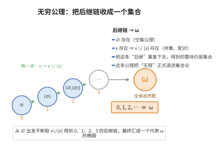

# 无穷公理（Axiom of Infinity）

> **一句话大白话**：数学明确规定"无穷"是真的存在的——至少有 $0,1,2,3,\dots$ 这么一长串永远数不完的集合。
>
> **小例子**：自然数集 $\mathbb{N}=\{0,1,2,3,\dots\}$ 就是无穷公理保证存在的那个无穷集合，它永远会有"下一个"数。

## 介绍

无穷公理断言存在一个无穷集合——具体来说，存在一个归纳集（inductive set）。归纳集是指包含 ∅ 且对后继运算封闭的集合，即满足：∅ ∈ I，且若 x ∈ I，则 x ∪ {x} ∈ I。无穷公理保证了自然数集 ℕ 的存在，是数学中引入无穷的第一个明确公理。

无穷公理是 ZFC 中最具"存在性"色彩的公理之一。在此之前的所有公理（空集、配对、并集、幂集）都只产生有限集合或依赖于已有集合。无穷公理明确断言一个全新的、无限的对象的存在，这是数学从有限跨越到无限的关键一步。

## 几何直观

图意在说明：空集加上“后继”操作只能一步步造出有限数，无穷公理的作用是把这一整条链打包成一个集合 ω——无限由此合法进入集合论。

## 分析

**形式化表述：**
$$ \exists I (\emptyset \in I \land \forall x (x \in I \rightarrow x \cup \{x\} \in I)) $$

**数学内涵：**
- 存在一个归纳集 I
- 自然数集 ℕ 定义为所有归纳集的交集（即最小的归纳集）
- 在 von Neumann 构造中：0 = ∅, 1 = {∅}, 2 = {∅, {∅}}, ...
- 无穷公理保证了 ℕ 是一个集合（而非真类）

**结构特点：**
- 无穷公理是 ZFC 中唯一保证无限集合存在的公理
- 自然数集 ℕ 是无穷公理最直接的应用
- 自然数上的数学归纳法原理由归纳公理（在 Peano 公理中）保证，但自然数集的存在由无穷公理保证

**应用：**
- 定义自然数集 ℕ
- 构造整数 ℤ、有理数 ℚ、实数 ℝ（均需无穷公理）
- 定义序列、可数集合、极限等概念
- 在递归论和可计算性理论中起基础作用

## 思考过程

无穷公理的历史可以追溯到对"无穷"概念的哲学争论。古希腊数学家（如亚里士多德）区分了"潜无穷"（potential infinity）和"实无穷"（actual infinity），并倾向于只接受潜无穷。Cantor 的集合论革命性地引入了实无穷概念——将无穷视为一个完整的、可被数学处理的对象。

对无穷公理的需求源于自然数集 ℕ 的构造。在 ZFC 中，每个自然数可以被定义为 von Neumann 序数：
- 0 = ∅
- 1 = {∅} = {0}
- 2 = {∅, {∅}} = {0, 1}
- n = {0, 1, ..., n-1}

但仅凭有限集合的构造，我们永远无法得到"所有自然数的集合"——这是一个无限的对象。无穷公理正是为了跨越这个"有限到无限"的鸿沟而设立的。

有趣的是，无穷公理在 ZFC 中是最"强"的存在性假设之一。一些数学哲学流派（如有限主义、直觉主义）拒绝接受实无穷，因此也不接受无穷公理。

## 证明过程

无穷公理是一条公理，不需要证明。以下讨论其合理性和必要性。

**合理性：**
- 无穷公理与数学实践中对无穷的广泛使用一致
- 大多数数学家接受自然数集 ℕ 作为一个合法的数学对象
- 无穷公理不会导致已知的悖论（在 ZFC 框架内）

**必要性：**
- 没有无穷公理，所有集合都是有限的（或遗传有限的）
- 无法构造自然数集 ℕ，无法构造实数集 ℝ
- 大部分数学分析、拓扑学、代数将无法进行
- 只有有限数学或"有穷主义"数学可以在没有无穷公理的情况下发展

**独立性：**
- 无穷公理独立于 ZFC 的其他公理
- 遗传有限集合的全体（V_ω）构成 ZFC-无穷公理的一个模型
- 在这个模型中，所有集合都是有限的，但其他 ZFC 公理（除无穷公理外）都成立
- 因此，无穷公理是 ZFC 中不可被其他公理推导出的真正的存在性假设

## 课堂问答

**老师**：只靠有限构造，能不能"攒"出自然数全体？

**学生**：不能。每个自然数都能造，但"全体"是无限对象，需要无穷公理来跨越：$\exists I\,(\varnothing\in I\land\forall x\,(x\in I\to x\cup\{x\}\in I))$。然后 $\mathbb N$ 取所有归纳集之交，即最小归纳集。

**老师（追问）**：它是 ZFC 里最强的存在性假设吗？

**学生**：它是最具存在性色彩的一条。其余公理要么只生成有限结构，要么依赖已有集合；去掉无穷公理，遗传有限集全体 $V_\omega$ 仍是其余公理的模型。

**老师（拓展）**：有限主义与直觉主义如何看待它？

**学生**：它们拒斥实无穷，因此拒斥这条公理，只能停留在有穷主义数学。常见误区是把序列的"潜无穷"直觉当作公理——公理断言的是实无穷集合的存在。
