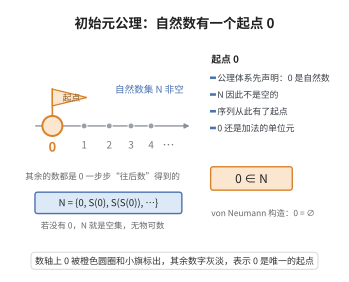

# 初始元公理

> **一句话大白话**：自然数不是空谈，它真的有一个"起点"——数字 $0$。
>
> **小例子**：$0$ 是自然数，记作 $0\in\mathbb{N}$，其它自然数 $1,2,3,\dots$ 都是从它一步步"往后数"出来的。

## 介绍

初始元公理是 Peano 公理体系的第一条公理，它断言存在一个自然数 0。这个看似简单的声明是整个自然数公理体系的起点——它告诉我们自然数不是空集，至少有一个元素。

在 Peano 的原始表述中，初始元是 1（而非 0），这反映了 19 世纪末数学家的习惯。现代数学通常使用 0 作为自然数的起点，因为 0 在代数结构中具有更好的性质（是加法单位元）。

## 几何直观

图意在说明：Peano 公理不预设自然数非空，第一条先把 0 立为起点；有了它，N 才不是空集，后继链才有出发的地方。

## 分析

**形式化表述：**
$$ 0 \in \mathbb{N} $$

**数学内涵：**
- 0 是自然数集合 ℕ 中的一个元素
- 0 是自然数序列的起点
- 0 在加法运算中充当单位元：∀n (n + 0 = n)

**与后继公理的关系：**
- 初始元公理提供了自然数结构的"起点"
- 后继公理允许我们从 0 出发生成所有自然数
- 二者结合，自然数集 ℕ 可以表示为 {0, S(0), S(S(0)), ...}

**在 ZFC 中的实现：**
- 在 von Neumann 构造中，0 = ∅
- 在 Zermelo 构造中，0 = ∅

## 思考过程

为什么需要一条公理来声明"0 是自然数"？因为在形式化公理体系中，我们不能假设任何对象的存在。Peano 公理体系没有预设任何集合论或其他数学理论，因此必须明确声明自然数集非空。

选择 0 还是 1 作为起点，本质上是一个约定问题。Peano 最初使用 1，但后来数学界普遍采用 0，因为：
- 0 是加法的单位元
- 0 使自然数集在加法下成为含幺半群
- 0 在集合论中对应空集，是最自然的"起点"

## 证明过程

初始元公理是一条公理，不需要证明。以下讨论其合理性和必要性。

**合理性：**
- 自然数包含 0（或 1）是数学的直观事实
- 0 作为自然数的起点具有清晰的概念基础

**必要性：**
- 没有初始元公理，自然数集可能是空集
- 后继公理只有在存在起点时才能生成自然数序列
- 初始元公理确保了自然数集非空，是整个 Peano 公理体系的基础

**独立性：**
- 初始元公理独立于 Peano 公理体系的其他公理
- 其他公理（后继、单射、归纳）都不蕴含任何自然数的存在

## 课堂问答

**老师**：为什么要把"$0$ 是自然数"单列成一条公理？

**学生**：因为 Peano 体系不预设任何对象的存在，必须显式声明自然数集非空：$0\in\mathbb N$。它提供起点，配合后继公理生成 $\{0,S(0),S(S(0)),\dots\}$。

**老师（追问）**：起点取 $0$ 还是 $1$，有数学后果吗？

**学生**：本质是约定。Peano 原用 $1$；现代多用 $0$，因为 $0$ 是加法单位元，使 $(\mathbb N,+)$ 成为含幺半群，且对应 von Neumann 构造中的 $0=\varnothing$。

**老师（拓展）**：它独立于其余公理吗？

**学生**：独立。后继、单射、归纳公理都不蕴含任何自然数的存在。常见误区是把 $\mathbb N$ 的存在当作默认——它的存在来自这条公理（或 ZFC 的无穷公理）。
