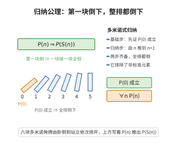

# 归纳公理

> **一句话大白话**：就像推倒一排多米诺骨牌——第一块倒了（$0$ 成立），而且每块倒了都能推倒下一块，那么整排骨牌全都会倒。
>
> **小例子**：要证明所有自然数都有"邻居"，先看 $0$ 成立，再证"若 $n$ 成立则 $S(n)$ 也成立"，于是 $0,1,2,3,\dots$ 全都成立。

## 介绍

归纳公理（又称数学归纳法原理）指出：若 P(0) 成立，且对任意自然数 n，P(n) 蕴含 P(S(n))，则对所有自然数 n，P(n) 成立。归纳公理是 Peano 公理中唯一一条"非构造性"的公理，它是一条公理模式（在二阶形式中是一条公理，在一阶形式中是一个模式）。

归纳公理是自然数理论的核心，它使得我们能够证明关于所有自然数的命题。数学归纳法是数学中最基本的证明方法之一，广泛应用于数论、组合数学、计算机科学等各个领域。

## 几何直观

图意在说明：归纳法把“验证 0”和“由 n 推到 n+1”两步合成一次对全体自然数的遍历，这正是多米诺骨牌式的连锁。

## 分析

**形式化表述（二阶形式）：**
$$ \forall P (P(0) \land \forall n (P(n) \rightarrow P(S(n))) \rightarrow \forall n P(n)) $$

**数学内涵：**
- 归纳公理确保了自然数集是"最小的"归纳集
- 它排除了自然数结构中的"非标准元素"
- 归纳公理是自然数上递归定义的基础

**与 ZFC 无穷公理的关系：**
- 在 ZFC 中，ℕ 定义为所有归纳集的交集，归纳原理自动成立
- 在 Peano 公理体系中，归纳公理是独立公理，用于刻画自然数的"最小性"

**应用：**
- 证明加法结合律、交换律
- 证明乘法分配律
- 证明各种数论性质（如算术基本定理）
- 递归定义函数（如斐波那契数列）

## 一阶与二阶：量词作用在哪里

这里的"一阶 / 二阶"是**逻辑语言的阶（order）**，指的是**量词允许作用在什么对象上**，与"一阶导数、二阶导数"无关。

一句话：一阶逻辑只能对"个体"说"所有 / 存在"；二阶逻辑还能对"个体的集合、性质、关系"说"所有 / 存在"。

### 一阶：量词只作用于个体

在一阶算术里，变量 $n,m,k$ 代表自然数个体，可以写

$$\forall n\,(n+1>n)$$

意思是：对每个自然数 $n$，都有 $n+1>n$。这里的 $\forall$ 只量化自然数个体；一阶语言中没有代表"自然数的任意性质"或"任意子集"的变量，因而不能直接写 $\forall P\,(\cdots)$。

于是归纳只能写成**公理模式**：对每一个一阶公式 $\varphi(n)$，各写一条

$$(\varphi(0)\land \forall n(\varphi(n)\to\varphi(n+1)))\to\forall n\,\varphi(n)$$

也就是说，它只对**能用一阶语言定义出来的性质**做归纳。

### 二阶：量词还能作用于集合与性质

二阶逻辑允许变量 $P$ 代表"自然数的子集"或"性质"，归纳公理因此可以写成单独一条：

$$\forall P\,\big(P(0)\land\forall n(P(n)\to P(n+1))\to\forall n\,P(n)\big)$$

读作：对任意性质 $P$，若 $0$ 有性质 $P$，且只要 $n$ 有 $P$ 就有 $n+1$ 有 $P$，那么所有自然数都有 $P$。用集合语言写就是

$$\forall A\subseteq\mathbb N\,\big(0\in A\land\forall n(n\in A\to n+1\in A)\to A=\mathbb N\big)$$

这里 $\forall A\subseteq\mathbb N$ 量化的是"自然数的任意子集"，而不是单个自然数——这正是"二阶"的含义。

### 这个差别为什么重要

二阶归纳比一阶归纳强得多：

- **二阶 Peano 公理**在标准语义下把自然数结构刻画到同构唯一，任何满足公理的系统本质上就是 $\mathbb N$。
- **一阶 Peano 算术**只有归纳公理模式，无法排除"非标准模型"：其中除了普通的 $0,1,2,\dots$ 之外，还有从 $0$ 出发用有限步走不到的非标准元素。一阶语言无法用某个公式把这些元素单独定义出来，归纳模式自然管不到它们。

直观地说：二阶说"任何子集，只要包含 $0$ 且对后继封闭，就是全集"；一阶只能说"任何**可定义**的子集，只要包含 $0$ 且对后继封闭，就是全集"。"可定义"这个限制，就是一阶与二阶梯度的关键差别。

一个类比：把自然数想成一群人。一阶逻辑可以说"对每个人 $x$，都有……"，量词只覆盖"人"；二阶逻辑还可以说"对每一群人 $A$，都有……"或"对每个人的每种性质 $P$，都有……"，量词覆盖"人的集合 / 性质"。所以阶数不是对象本身分"一阶的人、二阶的人"，而是**语言能对哪一层对象量化**。

再往上还有高阶逻辑：一阶量化个体，二阶量化个体的集合 / 关系 / 性质，三阶量化"集合的集合"，一般统称高阶逻辑。逻辑学界对"二阶逻辑算逻辑还是算集合论"有哲学争论，因为二阶量词很强；从技术上说，一阶逻辑有完备的证明系统，而二阶逻辑在标准语义下没有完备有效的证明系统。

## 思考过程

归纳公理背后的直觉是"多米诺骨牌效应"：如果第一块骨牌倒下（P(0) 成立），且每块骨牌的倒下会导致下一块骨牌倒下（P(n) → P(S(n))），那么所有骨牌都会倒下（∀n P(n)）。

为什么需要一条专门的公理来保证归纳法的合理性？因为归纳法本质上是"无穷推理"——它需要在一瞬间"遍历"所有自然数。在形式系统中，我们不能假设这种推理是合法的，必须明确将其列为公理。

归纳公理还有一个深刻的含义：它确保了自然数中没有"非标准"元素。如果存在一个"无穷大"的自然数 c 满足 c = S(c)，或者一个在 0 和后继操作之外的元素，归纳原理可以排除这些可能性。

值得注意的是，在一阶 Peano 算术中，归纳公理是一个公理模式（对每个公式 φ 有一条公理），这导致了一阶 Peano 算术不能完全刻画自然数结构（Gödel 不完备性定理）。

## 证明过程

归纳公理是一条公理，不需要证明。以下讨论其合理性和必要性。

**合理性：**
- 归纳公理符合自然数的直观：自然数"恰好"就是 0 及其反复应用后继得到的对象
- 数学归纳法在数学实践中被广泛使用，其有效性已被无数次验证

**必要性：**
- 没有归纳公理，无法证明关于所有自然数的命题
- 无法进行递归定义（加法、乘法等）
- 自然数集将包含"非标准元素"
- 大部分数论定理将无法证明

**独立性：**
- 归纳公理独立于 Peano 公理体系的其他公理
- 存在非标准自然数模型，其中前四条 Peano 公理成立但归纳公理不成立
- 这些模型包含"无穷大"自然数，超出标准自然数范围

## 课堂问答

**老师**：数学归纳法为什么必须单列为一条公理？

**学生**：因为它是一次"无穷推理"，要在一瞬间遍历全体自然数。二阶形式为 $\forall P\,(P(0)\land\forall n\,(P(n)\to P(S(n)))\to\forall n\,P(n))$，它确保 $\mathbb N$ 是最小归纳集、没有非标准元素。

**老师（追问）**：一阶与二阶形式有本质差别吗？

**学生**：有。二阶是一条、涵盖所有子集；一阶只是模式（每个公式一条），无法排除非标准模型——这正是 Gödel 不完备性下 $\mathrm{PA}$ 不能范畴地刻画 $\mathbb N$ 的根源。

**老师（拓展）**：它与 ZFC 的无穷公理是什么关系？

**学生**：在 ZFC 中 $\mathbb N$ 被定义为所有归纳集之交，归纳原理自动成立；而在 Peano 体系中它是独立的公理。常见误区是把归纳法当作"显然"——它的合法性恰恰来自这条公理。
