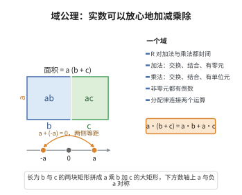

# 域公理

> **一句话大白话**：实数可以放心地加减乘除，而且拔出来的数还是实数，运算的规矩（交换、结合、分配、有零和一、能取负能取倒数）都照办。
>
> **小例子**：$\frac{2}{3}+4$ 等于 $\frac{14}{3}$ 还是实数；$2\times 3=3\times 2$（交换律）、$(2+3)+4=2+(3+4)$（结合律）、$2\times(3+4)=2\times3+2\times4$（分配律）都成立。

## 介绍

域公理规定了实数集 ℝ 上的加法 (+) 和乘法 (·) 运算满足域（field）的九条基本性质。域是一个代数结构，它包含两个运算，满足交换律、结合律、分配律，并存在单位元和逆元。域公理将实数系统的代数行为规范化，使其成为一个域。

域公理来源于有理数 ℚ 的基本算术性质，并推广到实数 ℝ。它确保了实数能够像我们期望的那样进行加减乘除运算。

## 几何直观

图意在说明：分配律把乘法摊到加法上，正是矩形面积的拼接；而相反数、倒数成对存在，让加减乘除都能在 R 内完成。

## 分析

**形式化表述：**

**加法公理：**
1. 交换律：∀a,b∈ℝ (a + b = b + a)
2. 结合律：∀a,b,c∈ℝ (a + (b + c) = (a + b) + c)
3. 零元：∃0∈ℝ ∀a∈ℝ (a + 0 = a)
4. 逆元：∀a∈ℝ ∃(-a)∈ℝ (a + (-a) = 0)

**乘法公理：**
5. 交换律：∀a,b∈ℝ (a·b = b·a)
6. 结合律：∀a,b,c∈ℝ (a·(b·c) = (a·b)·c)
7. 单位元：∃1∈ℝ (1≠0) ∀a∈ℝ (a·1 = a)
8. 逆元：∀a∈ℝ\{0} ∃(a⁻¹)∈ℝ (a·a⁻¹ = 1)

**分配律：**
9. ∀a,b,c∈ℝ (a·(b + c) = a·b + a·c)

**数学内涵：**
- 域公理使得 ℝ 成为特征为 0 的域
- (ℝ,+) 是 Abel 群，(ℝ\{0},·) 是 Abel 群
- 分配律连接了加法和乘法
- 域公理保证我们可以解线性方程 ax + b = 0

## 思考过程

域公理是从有理数 ℚ 的算术性质中抽象出来的。在古代，人们已经知道有理数（分数）的四则运算满足这些性质。随着数学的发展，数学家们意识到这些性质不仅仅适用于有理数，也适用于实数、复数以及其他代数结构。

域的概念由 Dedekind 在 19 世纪提出，后来由 Weber 和 Hilbert 等人形式化。域公理的美妙之处在于，它使用极少的几条规则就刻画了"可以进行加减乘除"的代数系统。

为什么需要明确列出每条公理？因为形式化要求我们不能预设任何隐含的性质。例如，交换律虽然在实数中成立，但并非在所有代数结构中都成立（如矩阵乘法不满足交换律），因此需要明确声明。

## 证明过程

域公理是公理，不需要证明。以下讨论其合理性和必要性。

**合理性：**
- 域公理完全符合实数算术的直观
- 这些性质在数学实践中被长期使用和验证

**必要性：**
- 没有域公理，我们无法规定实数的基本运算规则
- 域公理是代数运算的基础，没有它，更复杂的代数结构（向量空间、多项式环等）无法建立

**独立性：**
- 域公理中的各条公理是相互独立的，但通常作为一个整体接受
- 有些公理（如加法交换律）可以从其他公理推导出，但通常全部列出以保持对称性

## 课堂问答

**老师**：实数"能加减乘除"这件事，要用几条规则才能锁死？

**学生**：九条。加法的交换、结合、零元、负元；乘法的交换、结合、单位元（$1\neq0$）、逆元；再加连接二者的分配律。于是 $(\mathbb R,+)$ 与 $(\mathbb R\setminus\{0\},\cdot)$ 都是 Abel 群，$\mathbb R$ 是特征 $0$ 的域。

**老师（追问）**：为什么要把这些性质逐条啰嗦地列出？

**学生**：因为它们在别的结构中并不都成立：矩阵乘法不交换、$\mathbb Z$ 没有乘法逆元。形式化要求不预设任何隐含性质，必须显式声明。有了它们就能解线性方程 $ax+b=0$。

**老师（拓展）**：这九条彼此独立吗？

**学生**：并不全独立，例如加法交换律可由其余条目导出，但为对称与教学仍全部列出。常见误区是把"域"与"有序域"混同——域公理不含序，$\mathbb C$ 是域却不是有序域。
