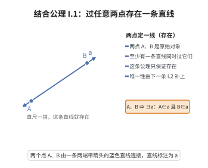

# I.1 结合公理 1

> **一句话大白话**：随便找两个点，总能拉出一条过它们的直线——两点能连成一条线，这是最朴素的直觉。
>
> **小例子**：纸上点 $A$ 和点 $B$，用直尺一画就有一条直线同时穿过这两点，肯定画得出来。

## 介绍

I.1 是 Hilbert 几何公理中第一组（结合公理）的第一条公理，它指出：过任意两点 A、B 存在一条直线 a。这是几何学中最基本的假设之一，它确立了点和直线之间的最基本关系——结合关系。

## 几何直观

图意在说明：一线只保证“至少有一条”，但已经足以让“连 A、B”这个动作合法；唯一性还要靠下一条公理补足。

## 分析

**形式化表述：**
过任意两点 A, B 存在一条直线 a。

**数学内涵：**
- 该公理断言直线的存在性：给定两点，至少有一条直线通过它们
- 与 I.2（唯一性）结合，过两点恰有一条直线
- "点"和"直线"是原始概念，"直线上"是原始关系

## 思考过程

Euclid 在《几何原本》中给出的第一个公设是："从任意一点到任意一点可作一条直线。"Hilbert 将其分为存在性（I.1）和唯一性（I.2）两条公理。

为什么需要分开？因为在形式系统中，存在性和唯一性是两个不同的断言，需要分别验证。I.1 保证至少有一条，I.2 保证至多有一条。

## 证明过程

这是公理，不需要证明。讨论其合理性：
- 这是几何学中最基本的直观：两点确定一条直线
- 在 Euclid 几何中，这是不言自明的基本事实
- 在非欧几何中，这条公理仍然成立（区别在于平行公理）

## 课堂问答

**老师**：先别急着画图。我问你：Hilbert 为什么把“过两点确定一条直线”拆成 I.1 和 I.2 两条？

**学生**：结论先行——因为“存在”和“唯一”是两个独立的断言。I.1 只保证至少有一条，写成 $\exists l\,(A\in l \wedge B\in l)$；I.2 保证至多一条。合起来才是“有且仅有一条”。常见误区是以为“两点定一线”天生含唯一性，但在球面几何里过对径点有无穷多条“直线”，所以唯一性并非逻辑必然。

**老师（追问）**：那 I.1 本身能保证这条线是一条“直”的、并且确实过 A、B 吗？

**学生**：它只规定“结合关系”，不规定曲直——“直线”是原始概念，“$A\in l$”才是被公理赋予意义的关系。另外要注意 $A,B$ 必须相异：若允许 $A=B$，过一点的线可有无穷多条而无从约束。严格表述应是“过任意两个不同点存在一条直线”。

**老师（拓展）**：把 I.1 放回整组公理看，它扮演什么角色？

**学生**：它是结合组的起点，与 I.3（每线至少两点）、I.6–I.8 一起给“点—线—面”搭起最小支架。对应 Euclid 第一公设“从任一点到任一点可作一直线”的存在性那一半；删掉它，连“直线 $AB$”这个记号都无处生根。
