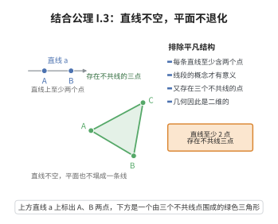

# I.3 结合公理 3

> **一句话大白话**：每条直线至少有两个点，而且世界上至少有三个“不挤在同一根线上”的点——否则几何就塌成一条没宽度的线甚至一个点了。
>
> **小例子**：直线上至少碰到两个点，比如数轴上的 $0$ 和 $1$；并且能找出三个不共线的点，比如三角形的三个顶点 $A$、$B$、$C$。

## 介绍

I.3 包含两个断言：每条直线上至少存在两个点；存在至少三个不共线的点。这确保了几何结构不是平凡的——直线不是空集或单点集，且空间不是一维的。

## 几何直观

图意在说明：直线至少含两点，线段才有意义；又存在不共线的三点，几何才不会退化成一维的直线世界。

## 分析

**形式化表述：**
1. 在每条直线上至少存在两个点
2. 存在至少三个不共线的点

**数学内涵：**
- 直线至少有两点，保证了"线段"的概念有意义
- 存在不共线的三点，保证了几何是二维的（平面）或更高维的
- 结合 I.8（存在四个不共面的点），可以扩展到三维空间

## 思考过程

为什么需要专门声明"存在三个不共线的点"？因为如果所有点都共线，几何就是"直线几何"，而非"平面几何"。这条公理确保了我们在二维平面上工作。

## 证明过程

这是公理，不需要证明。讨论其合理性：
- 直线的直观需要有至少两个点
- 平面几何需要至少三个不共线的点来定义"三角形"等概念

## 课堂问答

**老师**：这条公理其实塞了两个断言，为什么合并成一条？

**学生**：结论：一是“非退化”——每条直线至少含两个点，写作 $\forall l\,\exists A,B\in l,\ A\neq B$；二是“维数下界”——存在三个不共线的点，写作 $\exists A,B,C$ 不共线。前者让线段、延伸有意义，后者排除“所有点共线”的一维奇异模型。

**老师（追问）**：三个不共线点真的能保证得到“平面”吗？

**学生**：不能，它只锚定维数下界。三点不共线说明存在一个不在直线上的点，于是结构至少二维；真正造出平面还得靠 I.4。误区：把“三点不共线”等同于“平面存在”——它与 I.8 的“四个不共面点”配合，才逐层确立 1、2、3 维。

**老师（拓展）**：这些“存在性”公理在模型论里起什么作用？

**学生**：它们是“维数公理”，负责排除退化的平凡结构。删去它们，结合公理允许只含一条线甚至只含一个点的模型。所以 I.3、I.8 是保证欧氏几何模型“足够大”的下界条件。
