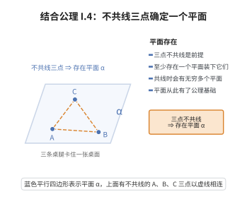

# I.4 结合公理 4

> **一句话大白话**：三个不在一条线上的点，总能卡定一个平面——就像三条桌腿总能稳稳撑起一个桌面。
>
> **小例子**：三角形 $A$、$B$、$C$ 三个顶点不共线，它们就唯一地在桌面这个平面上，这个平面就是 $\triangle ABC$ 所在的平面。

## 介绍

I.4 指出：过不共线的三点 A、B、C 存在一个平面 α。这是关于"平面"对象的基本公理，确立了点和平面之间的结合关系。

## 几何直观

图意在说明：三点不共线时总有一张平面能同时装下它们，就像三条桌腿撑起桌面；共线时平面才不唯一。

## 分析

**形式化表述：**
过不共线的三点 A, B, C 存在一个平面 α。

**数学内涵：**
- 该公理断言平面的存在性
- 三点不共线是前提条件（共线时有无穷多平面通过它们）
- 与 I.5 结合，过不共线三点有且仅有一个平面

## 思考过程

Euclid 在《几何原本》中没有明确定义平面，而是依赖于直观。Hilbert 将平面的存在性作为公理，使得平面的概念有了严格的基础。

## 证明过程

这是公理，不需要证明。讨论其合理性：
- 这是从一维（直线）到二维（平面）的自然推广
- 不共线三点确定一个平面是几何直观的基本事实

## 课堂问答

**老师**：I.4 说“存在一个平面”，前提为什么必须写“不共线”？

**学生**：结论：去掉不共线，命题就失去约束力。三点共线时，过这条线有无穷多个平面（像一本绕书脊翻开的书），“存在平面”仍真却区分不出面与线。写成 $\exists \alpha\,(A,B,C\in\alpha)$，前提 $A,B,C$ 不共线，才把平面与直线真正分开。

**老师（追问）**：这条本质上是“点—面”还是“线—面”的结合关系？

**学生**：是点与平面的结合关系，同时用到点与线的无关性（不共线）。它是从 I.1 的“两点定线”向三维推广的第一步，配合 I.5 的唯一性给出“平面 $ABC$”记号。误区：把 I.4 当成“任意三点确定平面”，忽略了不共线前提。

**老师（拓展）**：与 I.6 一起看，几何图像是什么？

**学生**：I.4 提供初始的共面三点，I.6 保证“一线若有两端在面内则整线在面内”，两者合起来说明一个平面由三个不共线的点张成、且线上点的延展都被这个面兜住——这就是“平面由不共线三点唯一张开”的完整形式化。
