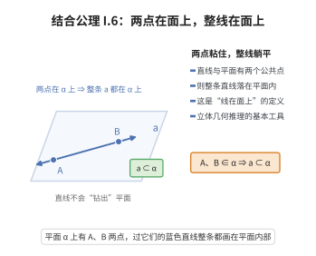

# I.6 结合公理 6

> **一句话大白话**：一条直线只要有两个点躺在某个平面上，整条线都会躺在这个平面上——两点定线，线跟着走。
>
> **小例子**：点 $A$、$B$ 都在桌面 $\alpha$ 上，那连 $A$、$B$ 的整条直线 $AB$ 就全都在桌面 $\alpha$ 上，不会钻出桌面。

## 介绍

I.6 指出：若直线 a 上有两点在平面 α 上，则直线 a 上所有点都在平面 α 上。这条公理将直线和平面的结合关系联系起来。

## 几何直观

图意在说明：直线只要有两个点粘在平面上，其余部分就无处可去，只能整条躺在平面内——这是立体几何的基本工具。

## 分析

**形式化表述：**
若直线 a 上有两点在平面 α 上，则 a 上所有点都在 α 上。

**数学内涵：**
- 如果一条直线与平面有两个公共点，则整条直线都在该平面上
- 这是"直线在平面上"的形式化定义
- 连接了第一组公理中关于点和直线、点和平面的关系

## 思考过程

这条公理可以被理解为"直线与平面的交如果包含两点，则直线被包含于平面"。这是几何直观中"直线在平面上"的严格形式化表述。

## 证明过程

这是公理，不需要证明。讨论其合理性：
- 符合几何直观：如果直线有两个点"粘在"平面上，那么整条直线都在平面上
- 这是立体几何推理的基本工具

## 课堂问答

**老师**：这条把“直线落在平面上”讲清楚了吗？它到底定义了“包含”还是“结合”？

**学生**：结论：它给出“若 $A,B\in\alpha$ 且 $A,B\in l$，则 $l\subseteq\alpha$”，即直线与平面有两个公共点则整线被包含。它把“直线在平面上”从一个直观动词变成一个可推理的命题。误区：这里两点必须相异、$l$ 是过它们的唯一那条直线（用 I.2），否则语言不严谨。

**老师（追问）**：只要“至少”两点就够推出 $l\subseteq\alpha$ 吗？

**学生**：够，只要这两点相异即可，其余点由“整条线”覆盖。反过来说，这条断言排除了“直线与平面恰交两点”的情形。结合 I.7，就能推出两平面相交必为整条直线。

**老师（拓展）**：它在构建三维几何中承担什么？

**学生**：它是“共面性”的传递工具：一旦直线上的两点在面内，整条线可用，从而线上任何新点自动共面。这是连接“点—线”与“点—面”关系的黏合剂，也是证明 I.7 的直观来源。
