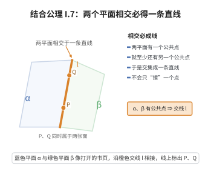

# I.7 结合公理 7

> **一句话大白话**：两个平面只要碰上一点，就绝不是“擦个点就走”，而是会交成一条整线——平面相交都是交出一长条。
>
> **小例子**：墙 $\alpha$ 和地面 $\beta$ 相交，除了墙角那个点，整条墙角线（好多好多点）都在两个平面上，擦出的是整条交线。

## 介绍

I.7 指出：若两个平面有一个公共点，则它们至少还有另一个公共点。这意味着两个不同的平面相交于一条直线（而不是一个点）。

## 几何直观

图意在说明：两平面只要有一个公共点，就会共享整条直线；于是交集绝不是单点，而是两个面沿交线“合页”般地相连。

## 分析

**形式化表述：**
若两个平面 α, β 有一个公共点，则它们至少还有另一个公共点。

**数学内涵：**
- 两个平面要么不相交，要么相交于一条直线
- 确保了平面交线的存在性
- 这是立体几何中"平面交线"概念的基础

## 思考过程

在三维空间中，两个平面相交于一条直线。这条公理确保了这个交集不是单点集——如果两个平面有一个公共点，它们实际上共享一条完整的直线。

## 证明过程

这是公理，不需要证明。讨论其合理性：
- 符合三维欧几里得空间中平面的几何直观
- 两个平面相交于一条直线是立体几何的基本事实

## 课堂问答

**老师**：两个平面“交于一条直线”这句话，公理却只说“至少还有另一个公共点”，够用吗？

**学生**：够用。结论：给定公共点 $A$，公理断言存在 $B\neq A$ 也同时在 $\alpha,\beta$ 上。于是由 I.6 与两点定线（I.2），$\alpha\cap\beta$ 至少含直线 $AB$；再说明交集中不可能有这条线外的点（否则由 I.5 唯一性会迫使两平面重合），就得到交恰为一条直线。误区：以为一个公共点就够——那会把“相切”误当成“相交”。

**老师（追问）**：那为什么不直接把“交于一条直线”设为公理？

**学生**：因为公理化追求最小假设。直接写结论会把 I.5、I.6 能推出的东西重复设为公理。“一个点→另一个点”是最弱前提，其余交给推理。这正体现 Hilbert 体系“公理尽量简单、定理尽量丰富”的风格。

**老师（拓展）**：它与平行公理如何呼应？

**学生**：在三维中两平面若不相交则平行。I.7 保证“相交时为整线”，配合平行公理（同一平面内过外点至多一条平行线），就把“面相接”的几种情形完整分类，也是立体几何画交线的合法性来源。
