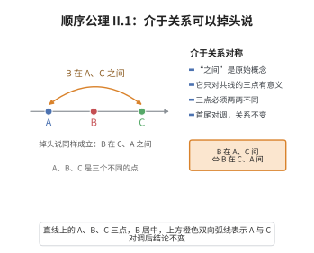

# II.1 顺序公理 1

> **一句话大白话**：说“B 夹在 A 和 C 中间”，这三个点就是三个不同的点，而且掉个头说“B 夹在 C 和 A 之间”也一样对。
>
> **小例子**：在数轴上 $A=0$、$B=1$、$C=3$，则 $B$ 在 $A$、$C$ 之间，三个点两两不同，反过来看 $B$ 在 $C$、$A$ 之间也成立。

## 介绍

II.1 指出：若 B 在 A, C 之间，则 A, B, C 是直线上三个不同的点，且 B 在 C, A 之间。这是顺序公理中最基本的"之间性"关系公理。

## 几何直观

图意在说明：说 B 在 A、C 之间，与说 B 在 C、A 之间是同一件事；三点还必须两两不同、共线，介于关系才有意义。

## 分析

**形式化表述：**
若 B 在 A, C 之间，则 A, B, C 是直线上三个不同点，且 B 在 C, A 之间。

**数学内涵：**
- "之间"关系是对称的：B 在 A, C 之间当且仅当 B 在 C, A 之间
- A, B, C 必须是不同的点
- A, B, C 必须共线

## 思考过程

"之间"关系是几何中的基本概念，Euclid 没有明确定义它。Hilbert 将其作为原始概念，并用公理规定其性质。II.1 规定了"之间"的对称性。

## 证明过程

这是公理，不需要证明。讨论其合理性：
- "之间"关系的对称性符合几何直观
- 如果 B 在 A 和 C 之间，自然也在 C 和 A 之间

## 课堂问答

**老师**：你说“$B$ 在 $A$、$C$ 之间”是天经地义的。那 II.1 到底多说了什么？

**学生**：它给了两条实质信息：其一，$A,B,C$ 两两不同；其二，“之间”是对称的——$B$ 在 $A,C$ 之间 $\Rightarrow$ $B$ 在 $C,A$ 之间。常见误区：以为“之间”还自动蕴含传递性，其实对称性由这条公理保证，而三点线性顺序要靠 II.3。

**老师（追问）**：为什么强调三点互异，而不写“至少两点”？

**学生**：因为“$B$ 在 $A,C$ 之间”若允许 $B=A$ 就无意义。互异性是“之间”关系良定义的前提，可写作 $A\neq B\neq C\neq A$ 且 $B\in \overline{AC}$。此外三点必须共线，否则“之间”根本无从谈起——这是隐含在原始概念里的。

**老师（拓展）**：把“之间”当原始概念，代价与收益各是什么？

**学生**：代价是它不可还原为“距离”或“$\in$”；收益是顺序公理全部围绕它展开，使我们能在尚没有“长度”的阶段谈论“介于”。这正是 Hilbert 把长度推给合同公理、把顺序独立成组的深意。
