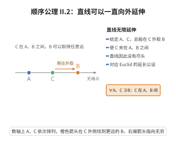

# II.2 顺序公理 2

> **一句话大白话**：从任意一个点再往外，总能继续延伸出更远的点——直线没有尽头，可以一直往外支出去。
>
> **小例子**：从点 $A$ 旁边有个点 $C$，那么总能在 $A$ 的另一侧再找一个点 $B$ 让 $C$ 夹在 $A$、$B$ 之间，比如 $A=0$、$C=1$，可取 $B=2$。

## 介绍

II.2 指出：对直线上任意两点 A, C，存在点 B 使得 C 在 A, B 之间。这条公理确保了直线是无限的——在任意点之外，还可以延伸。

## 几何直观

图意在说明：给定 A、C，总能在 C 的外侧再取一点 B，使 C 夹在中间；直线因此没有端点，可以不断延长。

## 分析

**形式化表述：**
对直线上任意两点 A, C，存在点 B 使得 C 在 A, B 之间。

**数学内涵：**
- 直线可以向任意方向无限延伸
- 给定两点 A, C，可以在 C 的"外侧"找到一点 B
- 这与 Euclid 的第二公设"直线可以无限延长"相对应

## 思考过程

这条公理是"直线无限性"的形式化表述。Euclid 的第二公设直观地描述了这一性质，Hilbert 用顺序关系将其严格化。

## 证明过程

这是公理，不需要证明。讨论其合理性：
- 直线应该是无限的，没有端点
- 这是"延长"操作的基础

## 课堂问答

**老师**：这条说“能在 $C$ 外侧找到 $B$”，它和 Euclid 的“直线可延长”是同一件事吗？

**学生**：本质相同，但更精确。写作 $\forall A,C\,\exists B$：$C$ 在 $A,B$ 之间。它保证从任一端不断向外延展。误区：以为它一上来就给出“直线无限长”——它其实是“邻近可外扩”的局部断言，靠反复使用才累积出无界性。

**老师（追问）**：为什么不用“直线长度无界”这种度量语言？

**学生**：因为顺序公理阶段还没有长度概念。用“存在更外的点”这种纯关系语言，才能不依赖合同公理地刻画无限延伸。度量版的无限性要等 Archimedes 公理（V.1）才登场。

**老师（拓展）**：它与 II.1、II.3 如何配合？

**学生**：II.3 保证三点中恰一个在中间，给出线性次序；II.2 保证序列向两端无限延伸；II.1 保证“之间”对称。三条合起来，直线才像一个双向无限的线性序，而非有限线段或圆圈。
