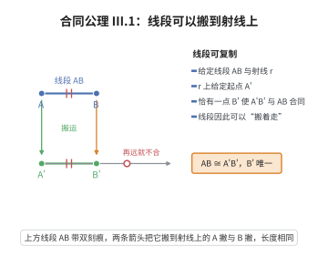

# III.1 合同公理 1

> **一句话大白话**：给一根线段长度，可以在任何一条射线的任意位置，从起点量出同样长的一段放到那里——线段能“搬着走”，而且位置唯一。
>
> **小例子**：已知线段 $AB$ 长 $5$ 厘米，从点 $A'$ 出发沿某条射线，就能在正前方唯一找到一个点 $B'$，使 $A'B'$ 也是 $5$ 厘米。

## 介绍

III.1 指出：给定线段 AB 和从点 A' 出发的射线 r，可以在射线 r 上唯一确定点 B' 使得 AB ≅ A'B'（线段 AB 与 A'B' 合同）。这条公理允许我们"移动"线段到任意位置。

## 几何直观

图意在说明：给定长度和一条射线，射线上恰有一点能与起点组成等长线段；线段由此可以“搬着走”，长度也有了传递的载体。

## 分析

**形式化表述：**
给定线段 AB 和射线 r 上一点 A'，可在 r 上唯一确定点 B' 使 AB ≅ A'B'。

**数学内涵：**
- 线段可以沿着射线"复制"到任意位置
- 合同（≅）是 Hilbert 几何中的原始概念
- 该公理保证了线段长度的可传递性

## 思考过程

Euclid 在《几何原本》中使用了"移动图形"的概念，但没有公理基础。Hilbert 的合同公理使得"图形移动"有了严格的形式化基础。

## 证明过程

这是公理，不需要证明。讨论其合理性：
- 线段可以"复制"到其他位置是几何直观的基本事实
- 这是"长度"概念的基础

## 课堂问答

**老师**：这条公理同时说了“存在”和“唯一”，为什么合同公理第一句就这么强？

**学生**：结论：给定线段 $AB$、射线 $r$ 及其上点 $A'$，在 $r$ 上存在唯一 $B'$ 使 $AB\cong A'B'$。存在让我们能“搬运”线段，唯一让“长度”成为良定义的数值。误区：以为移动图形是免费操作——Euclid 恰恰默认了它而无公理支撑。

**老师（追问）**：“唯一性”在这里防住了什么病态？

**学生**：它防止同一长度在一条射线上对应多个点。若允许两个 $B'$，则“从 $A'$ 沿 $r$ 量出长度 $|AB|$”就不确定，线段加法与比较都会崩。这也让射线上的点与长度之间形成一一对应，为坐标化奠基。

**老师（拓展）**：它与 SAS 公理有什么联系？

**学生**：III.1 提供“把边搬到指定位置”的能力，III.4 提供“把角搬到指定位置”的能力，二者正是 SAS（III.6）能作为全等判据的搬运基础。Hilbert 用“复制加唯一”取代了 Euclid 含混的“叠合”。
