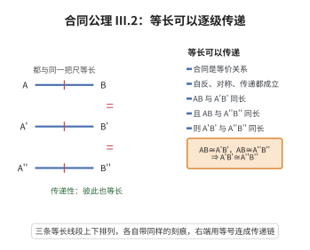

# III.2 合同公理 2

> **一句话大白话**：两段东西都和同一根“标准尺”一样长，那它们俩肯定也一边长——“同样长”是可以一级一级传下去的。
>
> **小例子**：若 $AB=A'B'=5$ cm，且 $AB=A''B''=5$ cm，那 $A'B'=A''B''$；就像尺子量出来都是 $5$ cm 的两根绳，它们一定一样长。

## 介绍

III.2 指出：若 AB ≅ A'B' 且 AB ≅ A''B''，则 A'B' ≅ A''B''。这是合同关系的传递性公理，使得"合同"成为等价关系。

## 几何直观

图意在说明：三段都与同一把标准尺等长，它们彼此也就等长；合同关系因此是等价关系，长度概念才有意义。

## 分析

**形式化表述：**
若 AB ≅ A'B' 且 AB ≅ A''B''，则 A'B' ≅ A''B''。

**数学内涵：**
- 合同关系是等价关系（自反性、对称性、传递性）
- 传递性使得"长度"概念有了意义

## 思考过程

合同公理的前三条（III.1-III.3）确立了线段合同的基本性质。III.2 的传递性使得我们可以比较不同线段的长度。

## 证明过程

这是公理，不需要证明。讨论其合理性：
- 合同传递性符合"相等"概念的直观
- 没有传递性，长度比较将失去意义

## 课堂问答

**老师**：为什么要单独设一条传递性公理？“相等”不该自动传递吗？

**学生**：结论：合同 $\cong$ 是原始关系，其传递性并不自带，必须公设：$AB\cong A'B'$ 且 $AB\cong A''B''$ $\Rightarrow$ $A'B'\cong A''B''$。有了它，$\cong$ 才成为等价关系，长度概念才有意义。误区：把逻辑等词“$=$”与几何关系“$\cong$”混为一谈。

**老师（追问）**：自反性、对称性又是从哪里来的？

**学生**：对称性与自反性都需要结合其他合同公理一并“拼装”出来，而非默认成立。换言之，等价三性质在 Hilbert 体系里是被逐条确立的，这正体现了对“合同”这一原始关系不加任何未经证明的假设。

**老师（拓展）**：传递性对“比较长度”关键在哪？

**学生**：它让我们引入统一的“标准线段”，把不同位置的线段都与同一参照比较，从而在无坐标的情形下定义“$AB<CD$”。这是度量几何从公理走向数系的必经一步。
