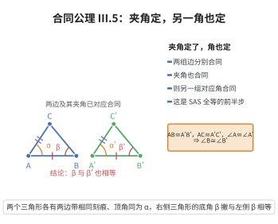

# III.5 合同公理 5

> **一句话大白话**：两个三角形有两边和它们的夹角都对应相等，那剩下的对应角也一定相等——前面对得齐，后面就都对得齐。
>
> **小例子**：若 $\triangle ABC$ 中 $AB=A'B'=4$、$AC=A'C'=3$、$\angle BAC=\angle B'A'C'=60^\circ$，那 $\angle ABC=\angle A'B'C'$ 同样成立。

## 介绍

III.5 指出：若三角形 ABC 与 A'B'C' 满足 AB ≅ A'B'，AC ≅ A'C'，∠BAC ≅ ∠B'A'C'，则 ∠ABC ≅ ∠A'B'C'。这是三角形全等判定定理的"过渡"引理。

## 几何直观

图意在说明：两边及其夹角对应合同后，另一组底角也被迫相等；这是 SAS 全等判定的“过渡引理”。

## 分析

**形式化表述：**
若 △ABC 与 △A'B'C' 满足 AB ≅ A'B'，AC ≅ A'C'，∠BAC ≅ ∠B'A'C'，则 ∠ABC ≅ ∠A'B'C'。

**数学内涵：**
- 两个三角形如果两边及其夹角对应合同，则另一组角也合同
- 这是 SAS 定理（III.6）的"弱化"版本
- 为证明 SAS 全等做准备

## 思考过程

III.5 和 III.6 共同构成了三角形全等的 SAS 判定定理。III.5 先保证了另一组角的合同，III.6 进一步保证第三边的合同，从而得到完整的全等。

## 证明过程

这是公理，不需要证明。讨论其合理性：
- 它符合"三角形全等"的直观
- 它为 SAS 全等定理提供了基础

## 课堂问答

**老师**：III.5 和 III.6 都在谈 SAS，为什么要拆成两条？

**学生**：结论：III.5 是“半边结果”——两边及其夹角合同，先推出另一组对应角合同（$\angle ABC\cong\angle A'B'C'$）；III.6 再补上第三边合同，合成完整全等。分层是为了让证明链可控。误区：把 III.5 当成独立的全等判据，它只给角的信息。

**老师（追问）**：只知两组角合同，能直接复制整个三角形吗？

**学生**：不能，还差边。III.5 只是一条引理，作用是把“边角边”中的部分信息转成角的信息，为 III.6 或 ASA 铺路。单独用它推不出 $BC\cong B'C'$。

**老师（拓展）**：这种“公理化的 SAS”与 Euclid 命题 I.4 有何不同？

**学生**：Euclid 的 I.4 靠“移动叠合”的直观证明，长期被诟病为不严格；Hilbert 索性把 SAS 的实质拆成 III.5 与 III.6 两条公理，避免使用未经公理化的“移动”，让全等判定获得坚实基础。
