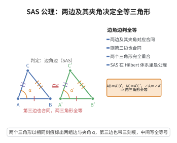

# III.6 SAS 公理（边角边公理）

> **一句话大白话**：两边和它们夹着的那个角都对应相等，两个三角形就完全一模一样（全等）——不用把三条边都量全。
>
> **小例子**：若 $AB=A'B'=4$、$AC=A'C'=3$、夹角 $\angle BAC=\angle B'A'C'=60^\circ$，则整条 $BC=B'C'$，两个三角形全等。

## 介绍

III.6（SAS 公理）指出：若两个三角形有两边及其夹角分别合同，则这两个三角形全等。具体来说，若 △ABC 与 △A'B'C' 满足 AB ≅ A'B'，AC ≅ A'C'，∠BAC ≅ ∠B'A'C'，则 BC ≅ B'C'，即两个三角形完全合同。

SAS 公理是欧几里得几何中最重要的全等判定定理，也是 Hilbert 公理体系中合同公理组的核心。

## 几何直观

图意在说明：只需两组边和它们的夹角，第三边与整个三角形就被锁定；SAS 是 Hilbert 体系中合同公理组的核心。

## 分析

**形式化表述：**
若 △ABC 与 △A'B'C' 满足 AB ≅ A'B'，AC ≅ A'C'，∠BAC ≅ ∠B'A'C'，则 △ABC ≅ △A'B'C'。

**数学内涵：**
- SAS 是三角形全等的核心判定准则
- 与 ASA、AAS、SSS 等定理一起（这些可由 SAS 推导出）
- 在欧几里得几何中，SAS 是公理，而在其他几何体系中可能不成立

## 思考过程

在 Euclid 的《几何原本》中，SAS 是作为定理给出的（命题 I.4），但 Euclid 的证明依赖于"移动图形"的直观，没有严格的公理基础。Hilbert 将 SAS 作为公理，以弥补这一缺陷。

SAS 之所以是公理而非定理，是因为在 Hilbert 体系中，我们无法用更基本的合同公理证明 SAS。它独立于其他合同公理，需要单独假设。

## 证明过程

这是公理，不需要证明。讨论其合理性：
- SAS 是三角形全等的基本判定准则，符合几何直观
- 如果两个三角形两边及其夹角分别相等，它们应该完全重合
- 在希尔伯特体系中，SAS 是独立公理，不能被其他合同公理证明

## 课堂问答

**老师**：SAS 这么基本，为什么在 Hilbert 里是公理而不是能证明的定理？

**学生**：结论：因为它独立于其余合同公理，推不出来，只能设为公理。形式：$AB\cong A'B'$、$AC\cong A'C'$、$\angle BAC\cong\angle B'A'C'$ $\Rightarrow$ $\triangle ABC\cong\triangle A'B'C'$。误区：以为有了线段与角的复制就能自动得到全等——若不设 SAS，边角信息并不足以钳制整个三角形。

**老师（追问）**：那 SSS、ASA、AAS 呢？

**学生**：它们都可由 SAS 推出，是定理而非公理。SAS 之所以占据“公理席”，是因为它对应“刚体运动保持边长与夹角”的最原始直觉，无法由更基本的合同公理再生。

**老师（拓展）**：非欧几何里 SAS 还成立吗？

**学生**：在双曲、椭圆几何中 SAS 依然成立——它只关乎局部度量一致性，与平行公理无关。可见 SAS 属中性几何，真正的欧氏/非欧分界在平行公理（IV.1）。这也印证了各组公理之间的独立性。
