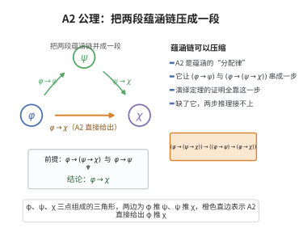

# A2 公理

> **一句话大白话**：这条公理让“推理链条”可以串起来：既然“前提能推出中间量”且“前提能推出‘中间量能推出结论’”，那前提就能直接推出结论——就像把两步并成一步。
>
> **小例子**：设 $\varphi=$“下雨”，$\psi=$“地湿”，$\chi=$“地滑”。如果下雨必使地湿，且一下雨就能推出“地湿则地滑”，那么下雨就能直接推出地滑，即“下雨→地滑”。

## 介绍

A2 公理是命题逻辑中的"分配律"公理模式： (φ → (ψ → χ)) → ((φ → ψ) → (φ → χ))。它描述了蕴涵的分配性质。

## 几何直观

图意在说明：有了 φ→ψ 和 φ→(ψ→χ)，A2 允许绕过中间站，直接得到 φ→χ，两步合成一步。

## 分析

**形式化表述：**
$$ (\varphi \rightarrow (\psi \rightarrow \chi)) \rightarrow ((\varphi \rightarrow \psi) \rightarrow (\varphi \rightarrow \chi)) $$

**数学内涵：**
- 该公理使得蕴涵的"传递性"可以被证明
- 它是演绎定理证明的关键
- 在真值表中是重言式

## 思考过程

A2 公理看起来比 A1 复杂，但它的作用非常明确：允许我们组合蕴涵链。在证明中，A2 使得我们可以从 φ→(ψ→χ) 和 φ→ψ 推出 φ→χ。

## 证明过程

这是公理，不需要证明。讨论其合理性：
- A2 是真值函数意义上的重言式
- 它与 A1、A3 一起构成了命题逻辑的完备公理系统

## 课堂问答

**老师**：这条"分配律"到底在分配什么？

**学生**：分配的是蕴含本身：$(\varphi\to(\psi\to\chi))\to((\varphi\to\psi)\to(\varphi\to\chi))$，它让我们把两步蕴涵链拼成一步。

**老师（追问）**：没有它会怎样？

**学生**：演绎定理（由 $\varphi\vdash\psi$ 得 $\vdash\varphi\to\psi$）的证明会丢掉关键一步——正是 A2 让我们由 $\varphi\to\psi$ 与 $\varphi\to(\psi\to\chi)$ 推出 $\varphi\to\chi$。

**老师（拓展）**：它是重言式吗？与其他公理是何关系？

**学生**：是，真值表恒真。A1、A2、A3 配合 MP 构成经典命题逻辑的完备公理系统。常见误区是把它当成数值乘法的分配律——这里分配的是蕴含。
