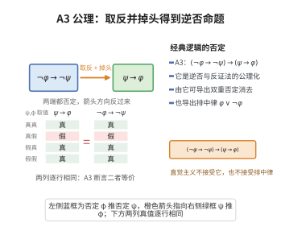

# A3 公理

> **一句话大白话**：这就是“反证法”和“逆否命题”的底子——只要“否认结论就一定否认前提”这句成立，那么反过来“前提一旦成立，结论也一定成立”。
>
> **小例子**：想证“考了 60 分→及格”（$\psi \to \varphi$），先证它的逆否“不及格→没考到 60 分”（$\neg\varphi \to \neg\psi$）。只要后者成立，原命题也就成立。

## 介绍

A3 公理是命题逻辑中的"反证法"公理模式： (¬φ → ¬ψ) → (ψ → φ)。它描述了否定与蕴涵之间的关系，是经典逻辑中"排中律"和"双重否定律"的基础。

## 几何直观

图意在说明：把蕴涵两端的命题同时否定、再把箭头掉头，得到的就是逆否命题；A3 断言这一步在经典逻辑中永远合法。

## 分析

**形式化表述：**
$$ (\neg \varphi \rightarrow \neg \psi) \rightarrow (\psi \rightarrow \varphi) $$

**数学内涵：**
- 该公理等价于"反证法"原理
- 与 A1、A2 一起，形成了一个完备的命题演算系统
- 在直觉主义逻辑中，这条公理不成立

## 思考过程

A3 公理是经典逻辑区别于直觉主义逻辑的关键。直觉主义逻辑不接受排中律，因此也不接受 A3。A3 本质上是"逆否命题"和"反证法"的形式化。

## 证明过程

这是公理，不需要证明。讨论其合理性：
- A3 在经典逻辑中是真值函数意义上的重言式
- 它反映了经典逻辑中的"否定"概念的特性

## 课堂问答

**老师**：$(\neg\varphi\to\neg\psi)\to(\psi\to\varphi)$ 是不是就是"逆否命题"？

**学生**：它是逆否与反证思想的公理化。由它能导出双重否定消去以及排中律 $\varphi\lor\neg\varphi$。

**老师（追问）**：它为什么在经典逻辑中成立、在直觉主义中不成立？

**学生**：它依赖把否定当作"真值翻转"的经典语义。直觉主义中"不存在 $\varphi$ 的证明"并不等于"$\varphi$ 为假"，因此不接受 A3，也不接受排中律。

**老师（拓展）**：它与 A1、A2 的分工是什么？

**学生**：A1 负责"引入真"，A2 负责"串联蕴涵"，A3 负责"处理否定"，三者与 MP 一起给出完备的经典演算。常见误区是把反证法（由 $\neg\varphi$ 导出矛盾而得 $\varphi$）与其逆否形式割裂看待——在经典逻辑中两者等价，在直觉主义中则双双失效。
