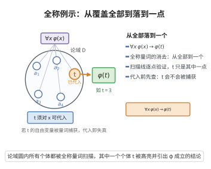

# 全称例示公理

> **一句话大白话**：只要某条性质对所有东西都成立，那对随便挑出来的一个具体东西也一定成立——就是从“全部”落到“其中一个”。
>
> **小例子**：已知“所有自然数 $n$ 都满足 $n \ge 1$”，那么取 $t=3$，就能推出“$3 \ge 1$”。

## 介绍

全称例示公理指出：∀x φ(x) → φ(t)，其中 t 是对 x 可代入的项（即代入后不会导致变量被量词意外捕获）。这条公理允许我们从全称命题推出个别实例。

## 几何直观

图意在说明：全称量词像一盏扫遍论域的灯，既然每个点都满足 φ，随手取出的 t 当然满足 φ(t)——前提只是 t 代入时不被别的量词捕获。

## 分析

**形式化表述：**
$$ \forall x \varphi(x) \rightarrow \varphi(t) $$
（其中 t 对 x 可代入）

**数学内涵：**
- 全称量词的"例示化"规则
- 如果所有 x 都满足 φ，则任意特定的 t 也满足 φ
- 必须满足"可代入"条件，避免变量冲突

## 思考过程

全称例示是"从一般到特殊"的推理形式。在数学证明中，当我们说"所有自然数都..."，然后推出"3 也..."，使用的就是全称例示。

## 证明过程

这是公理，不需要证明。讨论其合理性：
- 全称例示符合"全称量词"的语义解释
- 如果 ∀x φ(x) 为真，则对任意个体 t，φ(t) 也为真

## 课堂问答

**老师**：从一个全称命题出发，怎么合法地"落到"某个具体对象上？写出对应的公理式。

**学生**：先给结论：这就是全称例示（∀-例示）公理
$$\forall x\,\varphi(x)\rightarrow\varphi(t)$$
只要项 $t$ 对变量 $x$ 可代入（代入后不产生变量捕获），就能从"所有 $x$ 满足 $\varphi$"推出"这个特定的 $t$ 满足 $\varphi$"。例如由 $\forall n\in\mathbb{N}\,(n\ge 1)$ 取 $t=3$，得 $3\ge 1$。

**老师（追问）**：为什么必须强调"$t$ 对 $x$ 可代入"？给我一个不加这个条件就出错的例子。

**学生**：因为否则会把本该自由的变量"喂"进量词里，发生变量捕获。设 $\varphi(x)\equiv\exists y\,(y>x)$，取 $t=y$。$\forall x\,\exists y\,(y>x)$ 在 $\mathbb{R}$ 上为真，但盲目代入得 $\exists y\,(y>y)$，为假。问题在于 $t=y$ 中的 $y$ 被内层 $\exists y$ 捕获了，所以 $t$ 不可代入。常见误区是只盯真假、忽略项中自由变量是否被捕获。

**老师（拓展）**：全称例示和它的对偶——存在概括，形式上有何对称？各自在自然演绎里扮演什么角色？

**学生**：存在概括是
$$\frac{\varphi(t)}{\exists x\,\varphi(x)}$$
一个把全称量词"消去"，一个把存在量词"引入"，恰是消/引对偶。它们在自然演绎里分别是 ∀-消去与 ∃-引入，负责把量词命题在具体个体与存在断言间来回搬运，是构造反证法与做构造性证明的基础工具。
