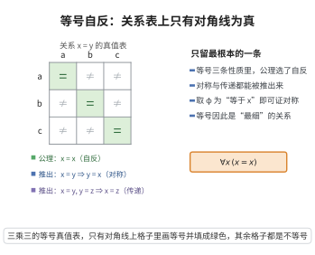

# 等号自反性

> **一句话大白话**：任何东西都等于它自己——这是“相等”最根本的一条性质，别的对称性、传递性都能从它推出来。
>
> **小例子**：$3=3$，$a+b=a+b$，任意对象 $x$ 都有 $x=x$。

## 介绍

等号自反性公理指出：∀x(x=x)。这是等号的最基本性质，断言每个对象都与自身相等。

## 几何直观

图意在说明：自反性让每个对象与自己相等，于是等号的真值表只剩对角线上的一串真；对称与传递都能由它加替换公理推出。

## 分析

**形式化表述：**
$$ \forall x (x = x) $$

**数学内涵：**
- 等号是自反关系
- 这是等号公理中最基本的一条
- 结合等号替换公理，可推导出等号的对称性和传递性

## 思考过程

等号自反性是不言自明的真理。在形式系统中，我们需要明确列出它，因为等号的所有其他性质（对称性、传递性）都可以从自反性和替换公理推导出。

## 证明过程

这是公理，不需要证明。讨论其合理性：
- 自反性是等号最根本的性质
- 没有自反性，"相等"的概念将失去意义

## 课堂问答

**老师**：等号三条经典性质里，哪一条被选作公理？为什么不是对称性或传递性？

**学生**：先给结论：选的是自反性
$$\forall x\,(x=x)$$
因为它是等号最根本的一条；配上等号替换公理，对称性 $x=y\to y=x$ 与传递性 $(x=y\wedge y=z)\to x=z$ 都能推出。做法是把替换公理中的 $\varphi$ 取成相应的性质，例如取 $\varphi(\xi)\equiv(\xi=x)$。

**老师（追问）**：用替换公理，怎么具体把对称性推出来？写下推理链。

**学生**：在替换公理 $x=y\to(\varphi(x)\to\varphi(y))$ 中取 $\varphi(\xi)\equiv(\xi=x)$。由 $x=y$ 得 $\varphi(x)\to\varphi(y)$，即 $(x=x)\to(y=x)$。再用自反性 $x=x$，由肯定前件得 $y=x$。于是 $x=y\to y=x$，对称性得证。常见误区是以为对称性"显然"，其实它要靠自反 + 替换才能生成。

**老师（拓展）**：把自反性与替换公理合起来，为什么说等号是"最细的"可实现代入的关系？这在模型论里意味着什么？

**学生**：因为任何满足"自反 + 全公式可替换（Leibniz 律）"的二元关系必是恒等关系：替换保证不可分辨者同一，自反保证每个对象与自身相等。反过来，恒等关系显然满足这两条。所以在任意结构中，等号被解释为真正的外延相等，而不可能被解释成更粗的等价关系——这正是把等号单列进一阶逻辑的原因。
