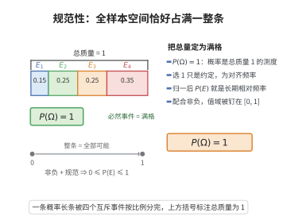

# 规范性（Normalization）

> **一句话大白话**：把“必然会发生的事”这个最大概率定为 1（满分），整个概率刻度就标准化了——就像满分是 100 分，不可能比这更高。
>
> **小例子**：掷一枚骰子，样本空间 $\Omega=\{1,2,3,4,5,6\}$。“掷出一个 1 到 6 之间的点”是必然事件，其概率 $P(\Omega)=1$。

## 介绍

规范性公理是 Kolmogorov 概率公理的第二条，指出：全样本空间 Ω 的概率为 1，即 P(Ω) = 1。这条公理将概率的取值范围标准化在 [0, 1] 之间。

## 几何直观

图意在说明：把必然事件的概率定为 1，等于把整块样本空间的总质量钉成满格；每个事件都只是这条总量的一段。

## 分析

**形式化表述：**
$$ P(\Omega) = 1 $$

**数学内涵：**
- 必然事件的概率为 1
- 概率是"标准化"的测度
- 结合非负性，概率的取值范围为 [0, 1]

## 思考过程

规范性公理将概率"标准化"：它确保概率的最大值为 1，对应必然事件。选择 1 作为最大值是约定的，类似于将角度标准化为 360 度或 2π 弧度。

## 证明过程

这是公理，不需要证明。讨论其合理性：
- 规范性是概率尺度标准化的自然选择
- 它使得概率的取值范围便于理解和使用

## 课堂问答

**老师**：为什么把必然事件的概率定为 $1$ 而不是任意常数？写出这条公理及其作用。

**学生**：先给结论：规范性 $P(\Omega)=1$。它把概率"归一化"，使 $P$ 成为总质量为 1 的测度。配合非负性，立刻得到 $0\le P(E)\le 1$：一方面 $P(E)\ge 0$，另一方面 $P(E)\le P(\Omega)=1$。选 $1$ 只是约定，就像把一周定为 7 天、把圆周定为 $360^\circ$，方便与"百分比""频率"互换。

**老师（追问）**：规范性里为什么用 $P(\Omega)=1$ 而不是更弱的"$P(\Omega)<\infty$"？只差一个常数，不能把质量重新缩放吗？

**学生**：可以缩放，但那样概率就不再是"频率的极限"了。把总质量归一到 1 后，$P(E)$ 恰是"长期相对频率"的期望值（大数定律：$\frac{1}{n}\sum_{k=1}^{n}\mathbf 1_{E}\to P(E)$）。若只要求有限，则对同一事件可以配出无穷多种数值，"概率"就失去唯一刻度；归一化正是为了让它与相对频率一致、并与"必然"对应 $1$ 的直觉吻合。常见误区是把 $P(\Omega)=1$ 当成"$\Omega$ 一定发生"的结果，其实它是定义，方向恰好相反。

**老师（拓展）**：如果样本空间不可数、单个点的概率都是 $0$，规范性还成立吗？这和"概率为 $1$ 的事件未必必然发生"冲突吗？

**学生**：仍成立。例如 $\Omega=[0,1]$ 上均匀分布，每个单点 $P(\{x\})=0$，但 $P(\Omega)=1$。这说明"概率 $1$"不等于"逻辑必然"、"概率 $0$"也不等于"不可能"——它们是测度意义下的"几乎必然/几乎不可能"。其根源正是可列可加性允许可列多个零测集并起来仍可能零测，而不可数多个才可能攒出正质量，这类直觉只有在测度框架下才自洽。
