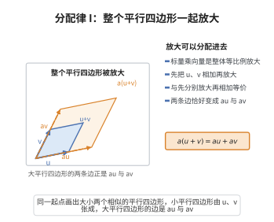

# 分配律 I

> **一句话大白话**：先按同一个数字把一份东西放大，再加起来，和先把几份加起来再放大，结果完全一样——放大和加法可以“拆开来做”。
>
> **小例子**：$2(u+v)=2u+2v$。比如 $u=(1,0)$、$v=(0,1)$，左边 $2(1,1)=(2,2)$，右边 $2(1,0)+2(0,1)=(2,0)+(0,2)=(2,2)$，两边相等。

## 介绍

分配律 I 指出：a(u + v) = au + av。这条公理连接了标量乘法与向量加法，是向量空间中两条分配律之一。

## 几何直观

图意在说明：先相加再放大，与分别放大再相加，得到的是同一个大平行四边形；放大倍数可以拆进每一条边里去。

## 分析

**形式化表述：**
$$ \forall a \in \mathbb{F} \; \forall u, v \in V \quad a(u + v) = au + av $$

**数学内涵：**
- 标量乘法对向量加法的分配律
- 连接了向量加法和标量乘法两种运算

## 思考过程

分配律是向量空间的核心性质，它确保了"缩放"操作与"加法"操作的相容性。

## 证明过程

这是公理，不需要证明。讨论其合理性：
- 分配律是向量空间代数结构的关键
- 没有分配律，向量加法和标量乘法将无法协同工作

## 课堂问答

**老师**：连接标量乘法与向量加法的第一条桥是什么？写出公理并说明它保证了什么。

**学生**：先给结论：分配律 I
$$\forall a\in\mathbb{F}\;\forall u,v\in V\quad a(u+v)=au+av$$
它说"缩放对加法分配"，保证标量作用于和的两种顺序一致：先加后缩 $=$ 先缩后加。这样 $a$ 才像域元素一样对 $V$ 的元素"线性作用"，是 $V$ 成为线性结构、允许把 $\sum a_i v_i$ 拆项合并的前提。

**老师（追问）**：分配律 I 是否意味着"标量可以像数一样和向量交换"？$au=ua$ 成立吗，为什么这个写法在某些语境下是错的？

**学生**：不能这样推。分配律 I 只说 $a(u+v)=au+av$，没有断言 $au=ua$——因为 $au$ 是 $a\in\mathbb{F}$ 作用于 $v\in V$，而 $ua$ 在向量空间里根本没有定义（$V$ 的元素不能左乘域元素）。只在 $V=\mathbb{F}$（一维）或把 $V$ 视为 $\mathbb{F}$-代数时，"交换"才有意义。常见误区正是把标量乘法当成域内乘法，随意写下 $au=ua$。

**老师（拓展）**：有了分配律 I，如何证明"标量乘零向量为零向量" $a\mathbf 0=\mathbf 0$？

**学生**：直接由分配律 I：
$$a\mathbf 0=a(\mathbf 0+\mathbf 0)=a\mathbf 0+a\mathbf 0$$
两边加上 $-a\mathbf 0$，得 $a\mathbf 0=\mathbf 0$。这说明分配律 I 是让标量对"零"和"和"的运算自洽的关键；至于 $0\cdot v=\mathbf 0$、$(-1)\cdot v=-v$ 这类需要标量加法配合的性质，则要再借分配律 II 来完成。
