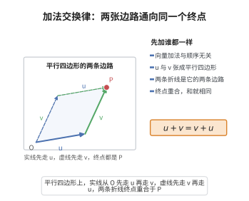

# 加法交换律

> **一句话大白话**：向量相加先加谁都一样，顺序无关紧要——就像先向北走再向东走，跟先向东走再向北走，终点是同一个。
>
> **小例子**：$u+v=v+u$。取 $u=(1,2)$、$v=(3,4)$，左边 $(4,6)$，右边 $(3,4)+(1,2)=(4,6)$，两边相等。

## 介绍

加法交换律是向量空间公理的第一条：u + v = v + u。它要求向量加法满足交换律，即向量的加法顺序不影响结果。

## 几何直观

图意在说明：u 与 v 张成平行四边形的两条边，先加谁都只是换了走法；终点重合，正是 u+v 与 v+u 相等最直观的样子。

## 分析

**形式化表述：**
$$ \forall u, v \in V \quad u + v = v + u $$

**数学内涵：**
- 向量加法是交换的
- 与结合律一起，向量加法构成 Abel 群
- 交换律是向量空间区别于一般群加法的特征

## 思考过程

向量加法的交换律来源于实际向量（如力、位移）的合成：两个力的和与顺序无关。这是向量空间最基本的直观性质。

## 证明过程

这是公理，不需要证明。讨论其合理性：
- 向量加法交换律符合物理直观
- 它是向量空间作为 Abel 群的基本要求

## 课堂问答

**老师**：向量空间 $(V,+,\cdot)$ 里，加法为什么要求交换？写出这条公理并说明它与"Abel 群"的关系。

**学生**：先给结论：加法交换律
$$\forall u,v\in V\quad u+v=v+u$$
向量加法连同结合律、零元、逆元构成一个 Abel 群，交换律正是"Abel"二字所要求的。几何上它对应位移、力的合成与先后次序无关；代数上，没有它 $V$ 只是"群"而非 Abel 群，标量乘法分配、线性组合的重排都会失去依据。

**老师（追问）**：交换律能否由其他公理推出，从而其实是多余的？试着从"标量 $1+1$"入手。

**学生**：其实——可以推出，它不是逻辑上独立的！对域中 $1+1$，先用分配律：
$$(1+1)(u+v)=(1+1)u+(1+1)v=(u+u)+(v+v)$$
又由单位元与分配律：
$$(1+1)(u+v)=1(u+v)+1(u+v)=(u+v)+(u+v)$$
两式相等得 $u+u+v+v=u+v+u+v$，左右各消去 $u$（左端）与 $v$（右端），得 $u+v=v+u$。所以交换律可由单位元、结合律、分配律推出；列表里单列它，是为了公理体系清晰，而非逻辑必需。常见误区正是"以为每条公理都不可省"。

**老师（拓展）**：既然可推出，为什么教材仍常把它列为公理？

**学生**：因为公理化有两种动机：逻辑最小化与直观清晰。把"向量加法像数的加法一样可交换"显式写出，能让初学者抓住几何图像，也让后续证明"可直接引用"而不必每次重推。更一般地，在**交换环上的模**里加法交换是定义的一部分；而在淡化分配律的弱结构（如近环、半环）中，交换性就不再自动成立，必须单独要求。是否冗余，取决于你选了哪套基础公理。
