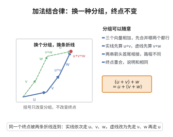

# 加法结合律

> **一句话大白话**：一次加几个向量时，先加哪两个都行，括号怎么放不影响最终结果——连加一串不用纠结先后。
>
> **小例子**：$(u+v)+w=u+(v+w)$。取 $u=(1,0)$、$v=(0,2)$、$w=(3,4)$，左边 $(1,2)+(3,4)=(4,6)$，右边 $(1,0)+(3,6)=(4,6)$，两边相等。

## 介绍

加法结合律是向量空间公理的第二条：(u + v) + w = u + (v + w)。它要求向量加法满足结合律。

## 几何直观

图意在说明：括号只规定先合并哪两个向量，首尾相接的折线因此换了路径，但两条折线的终点始终是同一点。

## 分析

**形式化表述：**
$$ \forall u, v, w \in V \quad (u + v) + w = u + (v + w) $$

**数学内涵：**
- 向量加法满足结合律
- 结合律使得表达式 u + v + w 无歧义
- 与交换律一起，构成 Abel 群

## 思考过程

结合律看似平凡，但它是代数结构的基本要求。没有结合律，向量加法将失去"自由组合"的能力。

## 证明过程

这是公理，不需要证明。讨论其合理性：
- 结合律是代数运算的基本要求
- 没有结合律，向量加法将无法有效定义

## 课堂问答

**老师**：向量加法里，为什么 $(u+v)+w=u+(v+w)$ 至关重要？写出公理并说明它带来的直接后果。

**学生**：先给结论：加法结合律
$$\forall u,v,w\in V\quad(u+v)+w=u+(v+w)$$
它让连加 $u+v+w$ 无歧义，也使"任意 $n$ 项之和"可以用任意括号方式计算而不变。它是 $V$ 成为群的必要一环——没有它，加法连"半群"都算不上，更无法讨论 $n$ 重和与线性组合 $\sum a_i v_i$。

**老师（追问）**：结合律和交换律一起，能推出哪些"重排不变"的结论？举向量加法之外的例子说明结合律并不平凡。

**学生**：结合律管"括号怎么放"，与交换律合起来管"顺序怎么排"，共同保证有限和的任意重排结果不变——这正是集合式记号 $\sum_{i\in I}a_iv_i$ 合法的前提。结合律绝不平凡：函数复合与矩阵乘法满足结合却一般不交换；而八元数（octonion）连结合律都失守，可见"结合"是一条需要单独要求的性质，不是运算的自带属性。

**老师（拓展）**：如果没有结合律，线性组合 $\sum_{i=1}^{n}a_iv_i$ 的定义会遇到什么麻烦？这解释了为什么代数结构总先要"结合"。

**学生**：因为 $\sum_{i=1}^{n}a_iv_i$ 本质是一串二元加法的迭代，必须靠结合律才能证明"无论如何加括号结果相同"，从而该记号才有唯一指称。缺了它，左结合与右结合可能给出不同元素，"$n$ 项和"根本无定义。一般地，结合律是让括号冗余、把二元运算提升为"任意有限元运算"的钥匙——这也是半群、群、环、模层层都把它排在首位的原因。
