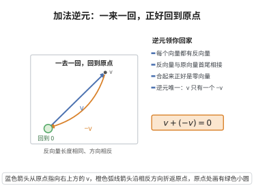

# 加法逆元

> **一句话大白话**：每个向量都能找到自己的“反向兄弟”$-v$，它俩一加就归零——走上台再原路退回去，正好回到原点。
>
> **小例子**：$v+(-v)=\mathbf{0}$。取 $v=(3,-4)$，其逆元 $-v=(-3,4)$，则 $(3,-4)+(-3,4)=(0,0)=\mathbf{0}$。

## 介绍

加法逆元公理指出：对每个向量 v ∈ V，存在逆元 -v ∈ V，使得 v + (-v) = 0。这保证了向量空间中的"减法"运算可行。

## 几何直观

图意在说明：反向量与原向量长度相同、方向相反，首尾相接正好抵消为零向量；每个向量都只有一个这样的逆元。

## 分析

**形式化表述：**
$$ \forall v \in V \; \exists (-v) \in V \quad v + (-v) = \mathbf{0} $$

**数学内涵：**
- 每个向量都有加法逆元（相反向量）
- 逆元是唯一的
- 减法可以定义为 v - w = v + (-w)

## 思考过程

加法逆元的存在使得向量空间中的"减法"可以定义，这与物理中"反方向向量"的概念对应。

## 证明过程

这是公理，不需要证明。讨论其合理性：
- 加法逆元保证了向量空间是群
- 它是向量运算完整性的基本要求

## 课堂问答

**老师**：写出加法逆元公理，并说明它使向量空间多了什么运算能力。

**学生**：先给结论：
$$\forall v\in V\;\exists(-v)\in V\quad v+(-v)=\mathbf 0$$
即每个向量都有相反向量。有了它才能定义减法 $v-w:=v+(-w)$，也才能在解方程时"移项"。它和零元、结合律一起，使 $(V,+)$ 成为群，$V$ 因而具备"可逆地加减"的能力。

**老师（追问）**：零元公理用的是"存在"、逆元用的是"对每个存在"，这个量词顺序为什么不能颠倒？逆元的唯一性又怎么证？

**学生**：顺序必须固定：$\exists\mathbf 0\,\forall v$ 表示有一个零元对谁都管用；$\forall v\,\exists(-v)$ 表示每个 $v$ 各有自己的逆。若把逆元写成 $\exists(-v)\,\forall v\,(v+(-v)=\mathbf 0)$，就等于要求"存在一个公共逆"，显然荒谬。唯一性：设 $v$ 有两个逆 $v',v''$，则 $v'=v'+\mathbf 0=v'+(v+v'')=(v'+v)+v''=\mathbf 0+v''=v''$。常见误区是忽略量词顺序，或忘记逆元唯一性也需要证明。

**老师（拓展）**：逆元的存在让向量空间成为 Abel 群；这一"Abel 群加标量作用"的组合，和一般的群作用有何本质不同？

**学生**：本质在于标量来自一个域（或环），于是作用不只"平移式"地置换元素，而是与 $V$ 的加法双向相容：$v\mapsto av$ 是群同态（$a(v+w)=av+aw$），$a\mapsto(v\mapsto av)$ 是环同态，两条共同把 $V$ 钉成 $\mathbb{F}$ 上的模。若只要一般群作用，就没有"缩放"与"求负"之间的比例关系，也就没有线性组合与基的概念。
