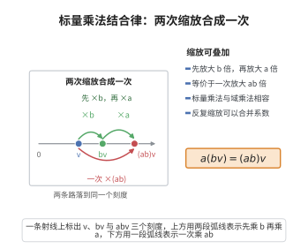

# 标量乘法结合律

> **一句话大白话**：先放大成倍再把整体又放大，等于直接把两个倍数乘起来一次放大——两次“缩放”可以合并成一次。
>
> **小例子**：$a(bv)=(ab)v$。取 $a=2$、$b=3$、$v=(1,1)$，左边 $2(3,3)=(6,6)$，右边 $6(1,1)=(6,6)$，两边相等。

## 介绍

标量乘法结合律公理指出：a(bv) = (ab)v，其中 a, b 是标量，v 是向量。这保证了标量乘法的"结合"性质。

## 几何直观

图意在说明：连续两次缩放可以合并成一次，乘 b 再乘 a 与直接乘 ab 落到同一刻度；这正是标量乘法与域乘法相容的几何含义。

## 分析

**形式化表述：**
$$ \forall a, b \in \mathbb{F} \; \forall v \in V \quad a(bv) = (ab)v $$

**数学内涵：**
- 标量乘法与域乘法的相容性
- 向量与标量的"复合"缩放等价于标量乘积的缩放

## 思考过程

这条公理确保了标量乘法的"一致性"：先缩放再缩放等于一次缩放。

## 证明过程

这是公理，不需要证明。讨论其合理性：
- 标量乘法结合律是向量空间的基本要求
- 它保证了缩放操作的代数一致性

## 课堂问答

**老师**：写出标量乘法结合律，并说明它把"两次缩放"变成了什么。

**学生**：先给结论：
$$\forall a,b\in\mathbb{F}\;\forall v\in V\quad a(bv)=(ab)v$$
它说"先按 $b$ 缩放、再按 $a$ 缩放"等于"按乘积 $ab$ 一次缩放"。于是 $V$ 上可以无歧义地定义"复合缩放"，与域乘法的结合性配套，使标量作用成为域 $\mathbb{F}$ 的一个"表示"。

**老师（追问）**：为什么需要它，才能说"域 $\mathbb{F}$ 通过标量乘法作用于 $V$"？这和表示论有什么关系？

**学生**：因为要定义一个保乘的映射，必须保持乘法结构。结合律加上 $1v=v$ 恰好给出
$$\mathbb{F}\to\operatorname{End}(V),\qquad a\mapsto(v\mapsto av)$$
即把每个标量看成 $V$ 上的线性算子，这正是表示论的雏形：$V$ 是 $\mathbb{F}$ 的一个表示。缺了结合律，这个映射就不保乘，"作用"的语义就崩了。

**老师（拓展）**：如果换成非结合结构（如八元数、李代数）作"标量"，这条公理该怎么改写？为什么交换环上情形更整齐？

**学生**：非结合情形要改用与结构匹配的相容律，或用"结合子 $[a,b,c]=(ab)c-a(bc)$"来度量偏差；李代数则改取雅可比恒等式。一般地，若底环 $R$ 非交换，还要区分左模 $r(sm)=(rs)m$ 与右模 $(mr)s=m(rs)$，二者不再等价。可见"结合 + 含幺 + 交换"正是让向量空间公理简洁整齐的代数前提。
