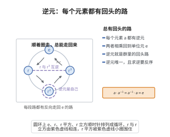

# 逆元

> **一句话大白话**：群里每个元素都有一个“反着做”的搭档 $a^{-1}$，两个一碰就回到单位元——像上了发条再反着拧，回到没动过的状态。
>
> **小例子**：整数加法群里 $3$ 的逆元是 $-3$，因为 $3+(-3)=0=e$；非零实数乘法群里 $3$ 的逆元是 $\frac{1}{3}$，因为 $3\times\frac{1}{3}=1=e$。

## 介绍

逆元公理指出：对每个 a ∈ G，存在 a⁻¹ ∈ G，使得 a·a⁻¹ = a⁻¹·a = e。逆元是"撤销"操作的元素。

## 几何直观

图意在说明：循环群中每个元素都有一条反向走回单位元的路，r 与 r 立方互为逆元，r 平方的逆元就是它自己，逆元正是群里的回头路。

## 分析

**形式化表述：**
$$ \forall a \in G \; \exists a^{-1} \in G \quad a \cdot a^{-1} = a^{-1} \cdot a = e $$

**数学内涵：**
- 每个元素都有逆元
- 逆元是唯一的
- 在加法群中，逆元记作 -a；在乘法群中，记作 a⁻¹

## 思考过程

逆元的存在使得群中的"除法"（或"减法"）成为可能。逆元对应于"反向操作"的概念——在整数加法中，3 的逆元是 -3；在非零实数乘法中，3 的逆元是 1/3。

## 证明过程

这是公理，不需要证明。讨论其合理性：
- 逆元是群区别于"半群"的关键特征
- 逆元使得方程 a·x = b 和 x·a = b 有唯一解

## 课堂问答

**老师**：写出逆元公理，并说明它使群比"半群、幺半群"多出什么。

**学生**：先给结论：
$$\forall a\in G\;\exists a^{-1}\in G\quad a\cdot a^{-1}=a^{-1}\cdot a=e$$
它保证每个元素都能被"撤销"。因此群里的方程 $a\cdot x=b$ 与 $x\cdot a=b$ 都有唯一解（$x=a^{-1}b$、$x=ba^{-1}$），群因而具备"可除"能力，这是幺半群普遍欠缺的——例如 $(\mathbb{Z},\times)$ 是幺半群，但 $2$ 在整数里无乘法逆元。

**老师（追问）**：逆元唯一吗？$(a^{-1})^{-1}$ 和 $(ab)^{-1}$ 分别等于什么？请给推导。

**学生**：都可由公理推出。唯一性：若 $b,c$ 都是 $a$ 的逆，则 $b=be=b(ac)=(ba)c=ec=c$。双重逆：$a$ 也是 $a^{-1}$ 的逆，故 $(a^{-1})^{-1}=a$。积的逆：$(ab)(b^{-1}a^{-1})=a(bb^{-1})a^{-1}=aa^{-1}=e$，同法得另一侧，故 $(ab)^{-1}=b^{-1}a^{-1}$——注意次序要**反转**，这是常见误区。

**老师（拓展）**：群中每个元素的"阶"如何定义？为什么用它能把群分类（如有限循环群）？

**学生**：元素 $a$ 的阶是最小正整数 $n$ 使 $a^n=e$（若不存在则为无穷阶）。由逆元存在，当阶为 $n$ 时 $a^{-1}=a^{n-1}$，于是 $a$ 生成的子群 $\langle a\rangle=\{e,a,\dots,a^{n-1}\}$ 恰有 $n$ 个元素，是循环群。Lagrange 定理进一步给出 $|G|$ 被 $n$ 整除，这条由"逆元加有限性"导出的整除关系，是群论分类的起点。可见逆元公理不只是"可除"，它支撑了阶、子群、商群这一整套理论。
