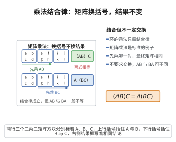

# 乘法结合律

> **一句话大白话**：算乘法时，加括号的顺序不影响结果，先算哪两个都一样。
>
> **小例子**：$(2 \times 3) \times 4 = 6 \times 4 = 24$，$2 \times (3 \times 4) = 2 \times 12 = 24$，两种算法得出同样结果。

## 介绍

环的乘法结合律公理指出：(a·b)·c = a·(b·c)。环的乘法运算必须满足结合律，但不需要满足交换律。

## 几何直观

图意在说明：矩阵乘法不交换，但先乘 AB 还是先乘 BC，最终的矩阵完全一样；环的乘法只要求这条结合律，连乘才有确定含义。

## 分析

**形式化表述：**
$$ \forall a, b, c \in R \quad (a \cdot b) \cdot c = a \cdot (b \cdot c) $$

**数学内涵：**
- 环的乘法是结合的
- 乘法不一定交换（如矩阵乘法）
- 乘法不一定有单位元或逆元

## 思考过程

乘法结合律是环的基本要求。与群不同，环的乘法不需要有逆元，也不需要交换。这使得环比域更一般、更灵活。

## 证明过程

这是公理，不需要证明。讨论其合理性：
- 乘法结合律是环的基本要求
- 大多数常见环的乘法都满足结合律

## 课堂问答

**老师**：环只要求乘法结合，不要求交换、单位元、逆元，这种克制有何代价与收益？

**学生**：结论先行——收益是环远多于域，代价是必须容忍非交换、无幺、有零因子。形式化即 $(a\cdot b)\cdot c=a\cdot(b\cdot c)$，它让连乘 $abc$ 无歧义。矩阵环 $M_n(\mathbb{R})$ 结合但不交换；$2\mathbb{Z}$ 结合交换却无单位元。

**老师（追问）**：若没有结合律，$abc$ 会出什么问题？

**学生**：常见误区是以为连乘天然合法。若无结合律，$(ab)c$ 与 $a(bc)$ 未必相等，$a^n$ 无从定义，二项式定理与指数律 $a^{m+n}=a^m a^n$ 全部崩塌。结合律正是加括号顺序无关、幂运算有意义的根本前提。

**老师（拓展）**：乘法的其余性质怎么补上？

**学生**：交换律另列得交换环，单位元另列得含幺环，逆元另列得除环或域。环只钉死结合律这一条，其余按需叠加，形成"环 $\subset$ 交换环 $\subset$ 含幺交换环 $\subset$ 域"的层次。
