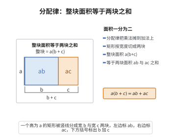

# 分配律

> **一句话大白话**：“先分开再乘、再相加”和“先相加再乘”结果一样，乘法能拆进加法里。
>
> **小例子**：$3 \times (4 + 5) = 3 \times 9 = 27$，而 $3 \times 4 + 3 \times 5 = 12 + 15 = 27$，两种算法结果相同。

## 介绍

分配律将环的两种运算（加法和乘法）连接起来，包含左右两条分配律：a·(b+c) = a·b + a·c 和 (a+b)·c = a·c + b·c。分配律是环定义的核心条件之一。

## 几何直观

图意在说明：把矩形按宽度切成两块，整块面积 a(b+c) 恰好等于两块面积 ab 与 ac 之和，这就是分配律在几何上的样子。

## 分析

**形式化表述：**
$$ \forall a, b, c \in R \quad a \cdot (b + c) = a \cdot b + a \cdot c $$
$$ \forall a, b, c \in R \quad (a + b) \cdot c = a \cdot c + b \cdot c $$

**数学内涵：**
- 左分配律和右分配律
- 在乘法交换环中，左右分配律等价
- 分配律是环与"仅有加法群"的结构的根本区别

## 思考过程

分配律是环中最关键的公理，它连接了加法和乘法两种运算。没有分配律，环就只是一个加法 Abel 群加上一个乘法半群，两者之间没有有意义的关系。

分配律在算术中表现为"展开"规则：a×(b+c) = a×b + a×c，这是代数计算的基础。

## 证明过程

这是公理，不需要证明。讨论其合理性：
- 分配律是环代数结构的关键
- 它将加法和乘法有机地联系起来
- 没有分配律，环将失去其核心特征

## 课堂问答

**老师**：分配律 $a\cdot(b+c)=a\cdot b+a\cdot c$ 被称为环里最关键的连接公理，为什么它不能被结合律或交换律替代？

**学生**：结论先行——因为只有分配律把加法与乘法连起来。结合律只管乘法内部，交换律只管顺序，而分配律规定乘法能展开进加法：$a\cdot(b+c)=a\cdot b+a\cdot c$ 与 $(a+b)\cdot c=a\cdot c+b\cdot c$。缺了它，$(R,+,\cdot)$ 只是两个不相干运算的拼接，$(a+b)^2$、因式分解全部失效。

**老师（追问）**：非交换环里左、右分配律可能只满足其一吗？

**学生**：常见误区是把左右分配律当同一条件。乘法不交换时二者独立，存在只满足单侧分配律的近环（near-ring）；交换环中由 $a\cdot b=b\cdot a$ 可推出二者等价。展开 $(a+b)(c+d)=ac+ad+bc+bd$ 严格依赖两条分配律同时成立。

**老师（拓展）**：分配律与"零元吸收"有什么关系？

**学生**：由分配律可推 $a\cdot 0=0$：因 $a\cdot 0=a\cdot(0+0)=a\cdot 0+a\cdot 0$，两边加 $-(a\cdot 0)$ 得 $0=a\cdot 0$。这条零元吸收律不是额外公理，而是分配律的推论，正说明连接两个运算的工作全由分配律承担。
