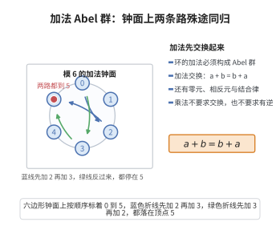

# 加法 Abel 群

> **一句话大白话**：环里的加法要把所有数当成一支“排好队、可进可退、交换顺序也行”的队伍来算。
>
> **小例子**：对整数来说，$(2+3)+4 = 5+4 = 9$，$2+(3+4)=2+7=9$；$3+5=5+3$；每一对加起来都能用减法“退回去”，例如 $7+(-7)=0$。

## 介绍

环的第一条公理要求 (R, +) 构成 Abel 群。即加法满足封闭性、结合律、存在单位元 0、存在逆元 -a，且加法交换。

## 几何直观

图意在说明：环的加法必须是交换群，先加 2 还是先加 3 都落到同一格；这条交换性让加法像钟面走针一样可以随意调换顺序。

## 分析

**形式化表述：**
- 封闭性：∀a,b∈R, a+b∈R
- 结合律：∀a,b,c∈R, (a+b)+c = a+(b+c)
- 零元：∃0∈R, ∀a∈R, a+0=0+a=a
- 逆元：∀a∈R, ∃(-a)∈R, a+(-a)=(-a)+a=0
- 交换律：∀a,b∈R, a+b=b+a

**数学内涵：**
- 环在加法下构成 Abel 群
- 这是环定义中加法部分的要求

## 思考过程

环的加法 Abel 群结构确保了环中可以进行"减法"运算，即加法的逆运算。这是环的最基本要求。

## 证明过程

这是公理，不需要证明。讨论其合理性：
- 加法 Abel 群是环结构的基础
- 整数环 ℤ、多项式环等都满足这个性质

## 课堂问答

**老师**：环 $(R,+,\cdot)$ 的第一条公理为什么要求 $(R,+)$ 是 Abel 群，而不是随便一个群？

**学生**：结论先行——因为环要能自由做"减法"，且加法顺序无关。封闭性保证 $a+b\in R$；结合律使 $(a+b)+c=a+(b+c)$ 可省括号；零元满足 $a+0=a$；逆元给出 $-a$；交换律保证 $a+b=b+a$。有了逆元，减法 $a-b:=a+(-b)$ 才有定义，故 $(R,+)$ 必须是群。

**老师（追问）**：若去掉交换律只保留群结构，哪些常见结论会失效？

**学生**：常见误区是以为加法天然交换。非交换群也满足群公理，此时 $(a+b)^2=a^2+ab+ba+b^2$ 不能合并为 $2ab$；交换律才保证 $ab+ba=2ab$，也保证零元唯一与 $-(a+b)=-a-b$ 的对称写法。

**老师（拓展）**：这条公理与后续乘法公理有依赖吗？

**学生**：完全独立。加法 Abel 群只约束 $+$，乘法结合律、分配律另行约束 $\cdot$ 及二者交互。矩阵环 $M_n(\mathbb{R})$ 加法交换而乘法不交换，说明加法交换是环的稳定共性。
