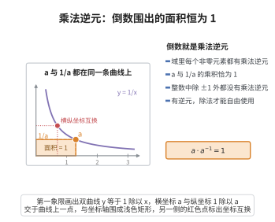

# 乘法逆元

> **一句话大白话**：除了 0，域里每个数都能“除回去”，都有个倒数能把它乘回 1，所以可以放心做除法。
>
> **小例子**：有理数域里 $7$ 的逆元是 $\frac{1}{7}$，因为 $7 \times \frac{1}{7} = 1$；但整数里 $2$ 就没有整数逆元，这正是整数不是域的原因。

## 介绍

**乘法逆元公理**规定：在域中，每个非零元 a 都存在一个乘法逆元 a⁻¹，使得 a·a⁻¹ = 1。这条公理是域区别于一般环的关键特征，它使得域中可以进行除法运算（除零外）。

## 几何直观

图意在说明：曲线上的点横纵坐标互为倒数，它与坐标轴围成的矩形面积恒为 1；这正是 a 乘 1/a 等于 1 的几何写照，也是域里除法可行的根据。

## 分析

乘法逆元公理的精确表述为：

∀a∈𝔽，a≠0 ⇒ ∃a⁻¹∈𝔽，s.t. a·a⁻¹ = a⁻¹·a = 1

由于乘法满足交换律，左逆和右逆等价。这条公理意味着：
- (𝔽\{0},·) 构成一个群，称为域的乘法群。
- 域中可以进行除法：定义 a/b = a·b⁻¹（b≠0）。
- 域中不存在零因子：若 a·b=0 且 a≠0，则两边乘以 a⁻¹ 得 b=0。

## 思考过程

在整数环 ℤ 中，大多数元素没有乘法逆元（只有 1 和 -1 有逆元）。这使得 ℤ 中不能进行一般的除法。为了能够自由地进行除法运算，我们需要将 ℤ 扩张到 ℚ，这正是域的概念的自然来源。

历史上，人们从有理数运算中抽象出"每个非零数都有倒数"这一性质。在域论中，这条公理是整个域论的核心。

## 证明过程

公理不需要证明。其必要性和合理性体现在：
- 除法是代数运算的基本需求，乘法逆元提供了除法的严格定义。
- 如果缺少乘法逆元，许多代数结论（如线性方程组求解、矩阵的逆、多项式根的公式）将无法成立。
- 特别地，ℤ 不是域正是因为非 ±1 的整数没有乘法逆元。

## 课堂问答

**老师**：乘法逆元公理 $\forall a\neq0,\ \exists a^{-1},\ a\cdot a^{-1}=1$ 是域区别于环的关键，它解锁了什么？

**学生**：结论先行——它解锁除法，并顺带消灭零因子。因为 $(\mathbb{F}\setminus\{0\},\cdot)$ 构成乘法群，可定义 $a/b:=a\cdot b^{-1}\ (b\neq0)$。若 $ab=0$ 且 $a\neq0$，两边乘 $a^{-1}$ 得 $b=0$，故域无零因子。

**老师（追问）**：整数 $\mathbb{Z}$ 为什么不是域？

**学生**：常见误区是以为"没有负数"或"不能开方"所致。真正原因是 $\mathbb{Z}$ 中除 $\pm1$ 外的整数都无乘法逆元，例如 $2$ 的倒数 $1/2\notin\mathbb{Z}$。按 $a/b$ 形式补全 $\mathbb{Z}$ 得 $\mathbb{Q}$，恰是"让每个非零元可逆"的最小扩张。

**老师（拓展）**：有了它，线性代数里哪些结论变得可能？

**学生**：逆矩阵 $A^{-1}$、线性方程组唯一解 $x=A^{-1}b$、多项式求根等都依赖系数域中非零元可逆。可以说"系数落在域上"是用高斯消元求解的隐前提。
