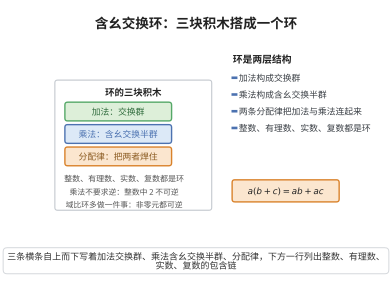

# 含幺交换环

> **一句话大白话**：域的“地基”是一个加、减、乘都跟平常整数算术一样顺畅，且交换顺序无所谓的结构，还带个单位元“1”。
>
> **小例子**：整数集 $\mathbb{Z}$ 就满足这些条件：可加可减、$3+5=5+3$、$3\times 5=5\times 3$，还有单位元 $1$（任何数乘 $1$ 还是它自己）。

## 介绍

**含幺交换环**（commutative ring with identity）是域公理的第一条，它规定了域 (𝔽,+,·) 在加法和乘法运算下必须满足的基本代数结构性质。这条公理将域置于环论的框架中，使得域首先是环，然后在此基础上增加额外的性质。

## 几何直观

图意在说明：环由加法交换群、乘法含幺交换半群和连接两者的分配律三块拼成；整数、有理数、实数、复数都满足这套结构，而域在此基础上再要求每个非零元素可逆。

## 分析

含幺交换环的条件包含以下具体内容：

1. **(𝔽,+) 是 Abel 群**：
   - 加法封闭性：∀a,b∈𝔽，a+b∈𝔽
   - 加法结合律：∀a,b,c∈𝔽，(a+b)+c = a+(b+c)
   - 加法交换律：∀a,b∈𝔽，a+b = b+a
   - 加法单位元（零元）：∃0∈𝔽，∀a∈𝔽，a+0 = a
   - 加法逆元：∀a∈𝔽，∃-a∈𝔽，a+(-a) = 0

2. **(𝔽,·) 是交换幺半群**：
   - 乘法封闭性：∀a,b∈𝔽，a·b∈𝔽
   - 乘法结合律：∀a,b,c∈𝔽，(a·b)·c = a·(b·c)
   - 乘法交换律：∀a,b∈𝔽，a·b = b·a
   - 乘法单位元：∃1∈𝔽，∀a∈𝔽，a·1 = a

3. **分配律**：∀a,b,c∈𝔽，a·(b+c) = a·b + a·c

## 思考过程

含幺交换环是环论中最常见的环类型。在历史上，人们长期使用实数、复数等数系进行运算，自然地认为加法和乘法满足交换律、结合律和分配律。直到 19 世纪，Hamilton 的四元数打破了乘法交换律，数学家们才开始系统研究各种环结构。

域要求乘法交换，这使得域中的代数运算与日常算术完全一致。交换性在多项式理论、线性代数等分支中至关重要。

## 证明过程

这是定义性公理，不需要证明。其合理性在于：
- 加法和乘法的基本性质（交换律、结合律、分配律）来源于日常算术的经验，是数学运算最自然的抽象。
- 含幺交换环广泛存在于数学中：ℤ、ℚ、ℝ、ℂ、多项式环 ℤ[x]、ℚ[x] 等。
- 含幺交换环是所有域论和交换代数讨论的起点。

## 课堂问答

**老师**：域的第一条公理说 $(\mathbb{F},+,\cdot)$ 是含幺交换环，为什么要把"交换"和"含幺"写进定义？

**学生**：结论先行——因为域还要求非零元可逆，而可逆必须相对乘法单位元 $1$，单位元存在是先决条件。含幺交换环要求：$(\mathbb{F},+)$ 是 Abel 群；$(\mathbb{F},\cdot)$ 是交换幺半群（封闭、结合、交换、有 $1$）；加乘由分配律 $a(b+c)=ab+ac$ 连接。

**老师（追问）**：四元数去掉交换律还能叫域吗？

**学生**：不能。常见误区是把"能加减乘除"当成域。四元数 $\mathbb{H}$ 是除环（每个非零元可逆）但乘法不交换，如 $ij=k$ 而 $ji=-k$，故不是域。域要求乘法交换，才保证左右逆一致、$a/b$ 无歧义。

**老师（拓展）**：能否举出含幺交换但无除法的例子？

**学生**：$\mathbb{Z}$ 是含幺交换环：$3\cdot 5=5\cdot 3$、有单位元 $1$，但 $2$ 无乘法逆元，故非域。可见域 = 含幺交换环 + 非零元可逆 + $0\neq1$，三块拼齐才封闭了除法。
