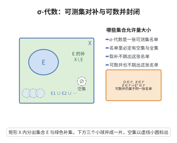

# σ-代数

> **一句话大白话**：σ-代数就是一张“官方准名单”，列好哪些集合允许量大小、测面积的。
>
> **小例子**：在实数轴上，取由“开区间的并”组成的 Borel σ-代数：空集在名单里，$(0,1)$ 在名单里，那么 $(0,1)$ 的补集 $(-\infty,0]\cup[1,+\infty)$ 也必须在名单里。

## 介绍

**σ-代数**（σ-algebra，也称 σ-域）是测度论的基础结构。它规定了哪些集合可以被"测量"。σ-代数 ℱ 是全集 X 的幂集 𝒫(X) 的一个子集族，满足对可数集合运算的封闭性。

## 几何直观

图意在说明：集合 E 与它的补在 X 内正好拼满，可数并也留在同一张名单里，这就是 σ-代数封闭性的几何样子。

## 分析

σ-代数 ℱ⊆𝒫(X) 满足以下三条公理：

1. **空集属于 ℱ**：∅∈ℱ
2. **对补集封闭**：若 E∈ℱ，则 E^c = X\E ∈ ℱ
3. **对可数并封闭**：若 {En}_{n=1}^{∞}⊆ℱ，则 ⋃_{n=1}^{∞} En ∈ ℱ

由这些条件可推出 σ-代数还对可数交封闭（由 De Morgan 律）。最小的 σ-代数包含 ∅ 和 X，而最大的 σ-代数就是幂集 𝒫(X)。

在实际应用中，最常用的 σ-代数是 Borel σ-代数（由开集生成）和 Lebesgue σ-代数（由 Lebesgue 可测集构成）。

## 思考过程

为什么需要 σ-代数？在实数集 ℝ 上，并非所有子集都是 Lebesgue 可测的（如 Vitali 集，依赖于选择公理）。因此，我们需要明确指定哪些集合是"可测"的，并确保这个集合族对常见的集合运算封闭，从而可以自由地进行集合运算而不超出可测范畴。

σ-代数概念的雏形出现在 Lebesgue 的博士论文中，后由 Borel、Carathéodory 和 Hahn 等人系统化。

## 证明过程

公理不需要证明。其合理性体现在：
- 对补集封闭保证了差集、对称差等运算的封闭性。
- 对可数并封闭保证了极限运算（如单调集合列的极限）的封闭性。
- 这些封闭性条件在测度论中至关重要，确保可测集在可数运算下保持可测性。

## 课堂问答

**老师**：σ-代数为什么要求对可数并封闭，而不直接把幂集 $\mathcal{P}(X)$ 当可测集族？

**学生**：结论先行——因为实数轴上存在不可测集（如依赖选择公理的 Vitali 集），不能把所有子集都当可测。σ-代数 $\mathcal{F}\subseteq\mathcal{P}(X)$ 要求 $\emptyset\in\mathcal{F}$、$E\in\mathcal{F}\Rightarrow E^c\in\mathcal{F}$、$\{E_n\}_{n=1}^{\infty}\subseteq\mathcal{F}\Rightarrow\bigcup_{n=1}^{\infty}E_n\in\mathcal{F}$，三条恰好保证可测集对常见运算封闭。

**老师（追问）**：对可数交封闭是公理吗？怎么得到？

**学生**：常见误区是把它当独立公理背。其实由 De Morgan 律从补与可数并推出：$\bigcap_{n}E_n=\left(\bigcup_{n}E_n^c\right)^c$，括号内可数并属于 $\mathcal{F}$，再取补仍属于 $\mathcal{F}$。故可数交封闭是推论。

**老师（拓展）**：最小与最大的 σ-代数分别是什么？

**学生**：最小的是 $\{\emptyset,X\}$，最大的是幂集 $\mathcal{P}(X)$。应用中最常用的是由开集生成的 Borel σ-代数与 Lebesgue σ-代数，前者是"能用开集拼出的所有集合"，为测度提供足够大的定义域。
