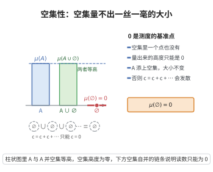

# 测度的空集性

> **一句话大白话**：“什么都没有”的那一坨，量起来的大小就是 0。
>
> **小例子**：实数轴上空集 $\emptyset$ 的长度是 $0$，类似“抛硬币永远不会出现‘既正又反’这个结果”，其概率是 $0$。

## 介绍

**测度的空集性公理**规定：空集的测度为零，即 μ(∅)=0。这是一条自然的规范化条件，类似于概率论中"不可能事件的概率为零"。

## 几何直观

图意在说明：空集没有点可量，柱高只能是 0；A 添上空集后高度不变，这条基准让测度不至于失去度量的意义。

## 分析

该公理的形式化表述为：

μ(∅) = 0

其中 ∅ 是空集。

这条公理在测度论中起到了"基准点"的作用。结合可列可加性，可以推导出测度的有限可加性、单调性等基本性质。在扩展实值 $\mu:\mathcal F\to[0,+\infty]$ 的一般设定下，非负性与可列可加性本身并不能排除 $\mu(\emptyset)=+\infty$；若存在某个可测集具有有限测度，才能由可列可加性推出 $\mu(\emptyset)=0$。因此一般定义中仍需明确采用这条规范化条件。

## 思考过程

空集表示"什么都没有"，其测度自然应为零。这条公理类似于概率论中 P(∅)=0 的要求。在数学分析中，空集的 Lebesgue 测度为零也是直观的：长度为 0 的区间是空集或单点集。

## 证明过程

一般情况下这是一条明确的规范化公理，不能只靠非负性和可列可加性证明。设 $\mu(\emptyset)=c$。把空集写成一列空集的不交并，只得到
$$c=\mu(\emptyset)=\sum_{n=1}^{\infty}c.$$
当 $0<c<+\infty$ 时右端为 $+\infty$，会产生矛盾；但 $c=+\infty$ 时等式为 $+\infty=+\infty$，并不矛盾。

**恒为无穷的反例：** 在任意 $\sigma$-代数 $\mathcal F$ 上定义 $\mu_\infty(E)=+\infty$（包括 $E=\emptyset$）。它取值于 $[0,+\infty]$，并且满足可列可加性：若一列互不相交的可测集全为空集，则两边都是 $+\infty$；若至少一个集合非空，则其并非空，且右端的和含有一个 $+\infty$，两边同样是 $+\infty$。因此非负性与可列可加性不能单独推出空集性。

**存在有限测度集时的推导：** 若存在 $A\in\mathcal F$ 使 $\mu(A)<+\infty$，对互不相交的序列 $A,\emptyset,\emptyset,\ldots$ 使用可列可加性，得
$$\mu(A)=\mu(A)+\sum_{n=1}^{\infty}c.$$
由于 $\mu(A)$ 有限且 $c\geq0$，该等式仅能在 $c=0$ 时成立。故此时可推出 $\mu(\emptyset)=0$；若没有这样的有限测度集，就应把空集性作为明确的规范公理保留。

## 课堂问答

**老师**：$\mu(\emptyset)=0$ 是公理，还是可由其他公理逼出的结论？

**学生**：结论先行——在一般扩展实值设定下，它是明确的规范公理；只有存在有限测度集时，才能由非负性和可列可加性推出。若 $\mu(\emptyset)=c$，空集的可列分解只给出 $c=\sum_{n=1}^{\infty}c$。当 $c=+\infty$ 时两边都为 $+\infty$，没有矛盾。事实上，在所有可测集（包括空集）上恒取 $+\infty$ 的函数也满足非负性和可列可加性，却是 $\mu(\emptyset)\neq0$ 的反例。若另有 $\mu(A)<+\infty$，则由 $\mu(A)=\mu(A)+\sum_{n=1}^{\infty}c$ 才迫使 $c=0$。

**老师（追问）**：它与概率论中哪条要求同构？

**学生**：常见误区是只说“级数发散”便声称一般情形必有矛盾，却忽略扩展实值中 $+\infty=+\infty$ 是有效等式。概率论还规定了 $P(X)=1$，因而整个样本空间就是有限测度集；由可列可加性即可推出 $P(\emptyset)=0$。对一般测度，$\mu(\emptyset)=0$ 则是排除恒为 $+\infty$ 等退化情形的明确规范化。

**老师（拓展）**：由它加可列可加性能推出什么？

**学生**：可推有限可加性与单调性：若 $A\subseteq B$，则 $B=A\cup(B\setminus A)$，$\mu(B)=\mu(A)+\mu(B\setminus A)\geq\mu(A)$。这使测度成为单调集函数，是积分理论中"面积随集合增大不减"的根据。

## 相关条目

- [12-测度论公理索引](index.md)
- [公理体系总索引](../index.md)
