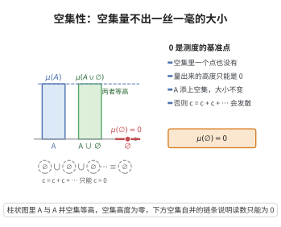

# 测度的空集性

> **一句话大白话**：“什么都没有”的那一坨，量起来的大小就是 0。
>
> **小例子**：实数轴上空集 $\emptyset$ 的长度是 $0$，类似“抛硬币永远不会出现‘既正又反’这个结果”，其概率是 $0$。

## 介绍

**测度的空集性公理**规定：空集的测度为零，即 μ(∅)=0。这是一条自然的规范化条件，类似于概率论中"不可能事件的概率为零"。

## 几何直观

图意在说明：空集没有点可量，柱高只能是 0；A 添上空集后高度不变，这条基准让测度不至于失去度量的意义。

## 分析

该公理的形式化表述为：

μ(∅) = 0

其中 ∅ 是空集。

这条公理在测度论中起到了"基准点"的作用。结合可列可加性，可以推导出测度的有限可加性、单调性等基本性质。如果没有这条公理，测度可能会在任何集合上都取无穷大，变得毫无意义。

## 思考过程

空集表示"什么都没有"，其测度自然应为零。这条公理类似于概率论中 P(∅)=0 的要求。在数学分析中，空集的 Lebesgue 测度为零也是直观的：长度为 0 的区间是空集或单点集。

## 证明过程

公理不需要证明。其必要性体现在：
- 如果没有 μ(∅)=0，则测度概念会失去"度量"的意义。
- 结合可列可加性，μ(∅)=μ(∅∪∅∪⋯)=μ(∅)+μ(∅)+⋯，如果 μ(∅)≠0，则会导致矛盾（无穷大级数发散），因此 μ(∅)=0 是逻辑上必需的。

## 课堂问答

**老师**：$\mu(\emptyset)=0$ 是公理，还是可由其他公理逼出的结论？

**学生**：结论先行——它可作公理，但在非负可列可加框架下也被逻辑逼出。若 $\mu(\emptyset)=c$，由可列可加性 $\mu(\emptyset)=\mu(\emptyset\cup\emptyset\cup\cdots)=\sum_{n=1}^{\infty}c$；非负性下该级数收敛必要求 $c=0$，否则和为 $+\infty$ 或振荡，产生矛盾。

**老师（追问）**：它与概率论中哪条要求同构？

**学生**：常见误区是把它当测度特有的会计约定。它正对应 Kolmogorov 公理 $P(\emptyset)=0$ 与 $P(X)=1$ 的规范化。空集是"什么都没有"，量出零大小是对度量概念最小的自洽要求。

**老师（拓展）**：由它加可列可加性能推出什么？

**学生**：可推有限可加性与单调性：若 $A\subseteq B$，则 $B=A\cup(B\setminus A)$，$\mu(B)=\mu(A)+\mu(B\setminus A)\geq\mu(A)$。这使测度成为单调集函数，是积分理论中"面积随集合增大不减"的根据。
