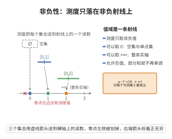

# 测度的非负性

> **一句话大白话**：量出来的“大小”永远不可能是负数，最小就是 0，最多可以大到无穷。
>
> **小例子**：一条长 3.5 的线段长度是 $3.5 \geq 0$；整个实数轴的长度是无穷大 $+\infty$，但绝不可能是“负长度”。

## 介绍

**测度的非负性公理**规定：测度 μ 是一个从 σ-代数 ℱ 到非负广义实数集 [0,+∞] 的函数。这意味着任何一个可测集的"大小"都不会是负数，且允许取值为无穷大。

## 几何直观

图意在说明：每个可测集都被送到横轴上一个非负读数，零点左侧空无一物，而右端允许取到正无穷。

## 分析

该公理的形式化表述为：

μ: ℱ → [0, +∞]

即对于任意 E∈ℱ，有 μ(E) ≥ 0 或 μ(E) = +∞。

非负性是"大小"概念的最基本性质：长度、面积、体积、概率等都不会是负数。允许无穷大是为了处理无界集合（如整个实数线的长度）。

## 思考过程

在直观上，长度、面积、概率都是非负的。非负性在测度论的推导中至关重要：它保证了测度级数的部分和单调递增，从而在和为无穷大时仍可定义。如果允许负测度，许多基本性质（如单调性、次可加性）将不再成立。

## 证明过程

公理不需要证明。其合理性是直观且显然的：
- 长度、面积、体积等都是非负的。
- 概率也是非负的（Kolmogorov 公理第一条）。
- 非负性保证了测度论中极限定理和收敛定理的成立。

## 课堂问答

**老师**：非负性 $\mu:\mathcal{F}\to[0,+\infty]$ 里"允许取 $+\infty$"是不是多余？

**学生**：结论先行——不多余，是必需的。非负性说 $\mu(E)\geq0$，值域取 $[0,+\infty]$ 允许无界集取无穷，如 $\mu(\mathbb{R})=+\infty$。若允许负值，测度级数的部分和不再单调递增，收敛性无从谈起。

**老师（追问）**：为什么负测度会毁掉理论？

**学生**：常见误区是以为负值只是换个符号。非负性使测度级数部分和单调递增，故极限（含 $+\infty$）总存在；一旦有负项，部分和可能振荡无极限，单调性、次可加性、单调收敛定理全部失效。

**老师（拓展）**：非负性在概率论里对应哪条？

**学生**：对应 Kolmogorov 第一公理 $P(A)\geq0$。概率、长度、面积、体积本质都是非负集函数，故非负性是"度量"这一语义的最低门槛。
