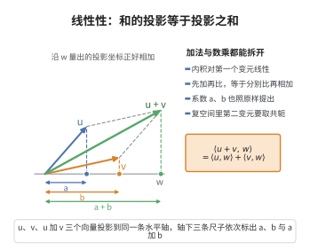

# 线性性

> **一句话大白话**：内积对第一个变元“有加法、能提系数”的脾气——先把两个向量拼起来再跟别人比，等于分别跟别人比再加起来；往前面乘个数，结果也乘同样的数。
>
> **小例子**：在 $\mathbb{R}^2$ 里取 $u=(1,0)$、$v=(0,1)$、$w=(2,2)$，则 $\langle u+v,w\rangle=\langle(1,1),(2,2)\rangle=1\times2+1\times2=4$，而 $\langle u,w\rangle+\langle v,w\rangle=2+2=4$，两者相等。

## 介绍

**线性性公理**（linearity）规定内积对第一个变元是线性的。结合对称性（或共轭对称性），可以推出内积对第二个变元是共轭线性的（复空间）或线性的（实空间）。整体上，内积是一个 **Hermitian 双线性形式**（或实双线性形式）。

## 几何直观

图意在说明：把 u 与 v 先叠加再和 w 比，与分别和 w 比再相加，得到的是同一组投影坐标。

## 分析

线性性公理的形式化表述为：

∀a,b∈𝔽，∀u,v,w∈V，⟨au+bv,w⟩ = a⟨u,w⟩ + b⟨v,w⟩

这称为对第一个变元的线性性。结合对称性公理，对第二个变元：
- 实空间：⟨u,av+bw⟩ = a⟨u,v⟩ + b⟨u,w⟩（线性）
- 复空间：⟨u,av+bw⟩ = ā⟨u,v⟩ + b̄⟨u,w⟩（共轭线性）

## 思考过程

线性性保证了内积与向量空间的线性结构兼容。在欧几里得空间中，(au+bv)·w = a(u·w)+b(v·w) 是线性性的直接体现。

在复内积空间中，通常约定内积对第一个变元线性、对第二个变元共轭线性（物理学中常用相反的约定）。这种不对称性源于复数的共轭结构。

## 证明过程

公理不需要证明。其合理性体现在：
- 线性性使得内积可以作为向量空间的"双线性"工具，用于研究线性变换、正交投影等。
- 在量子力学中，⟨ψ|φ⟩ 表示态 ψ 和 φ 的内积，线性性对应了态叠加原理。
- 线性性保证了 Gram-Schmidt 正交化过程、正交分解等基本算法的有效性。

## 课堂问答

**老师**：内积的线性性只对第一个变元提出 $\langle au+bv,w\rangle=a\langle u,w\rangle+b\langle v,w\rangle$，为什么第二变元要另眼相待？

**学生**：结论先行——因为复空间需要共轭对称，二者一结合，第二变元自动变共轭线性。实空间 $\langle u,av+bw\rangle=a\langle u,v\rangle+b\langle u,w\rangle$（线性）；复空间 $\langle u,av+bw\rangle=\bar a\langle u,v\rangle+\bar b\langle u,w\rangle$（共轭线性）。整体是 Hermitian 形式。

**老师（追问）**：若强行让两变元都线性，会出什么矛盾？

**学生**：常见误区是以为"双线性"才对称漂亮。若两变元都线性又要求共轭对称，则 $\langle iv,iv\rangle=i^2\langle v,v\rangle=-\langle v,v\rangle$，与正定性 $\langle v,v\rangle\geq0$ 冲突（除非 $v=0$）。所以必须牺牲一侧的线性。

**老师（拓展）**：这条公理在量子力学里有什么影子？

**学生**：态叠加原理正对应内积对第二变元的线性；Dirac 记号的 bra 与 ket 恰是"一侧线性、一侧共轭线性"的两面。线性性也保证了 Gram-Schmidt 正交化与正交投影算法的可行性。
