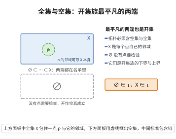

# 全集与空集

> **一句话大白话**：一个“开集家族”里，最“大”的那个（把一切全装进去的全集）和最“小”的那个（什么也不装的空集）都一定要算开集——这是开集概念的底线要求。
>
> **小例子**：在度量空间“整条实直线”$\mathbb{R}$ 上，$\varnothing$ 和 $\mathbb{R}$ 本身都是开集；任何一个合法的拓扑都至少包含这两个集合。

## 介绍

**全集与空集公理**是拓扑空间公理的第一条。它规定：空集和全集都是开集。这是开集概念最基本的要求。

## 几何直观

图意在说明：X 里每点都能把 X 本身当邻域，∅ 里没有点需要检验，两端因此自动合格，充当开集族的上下界。

## 分析

该公理的形式化表述为：

∅∈τ，X∈τ

其中 τ 是拓扑空间 X 上的拓扑（开集族）。

- ∅ 是空集，不包含任何元素。
- X 是全集，包含所有元素。

这条公理是所有拓扑的"基线"条件。任何拓扑都必须包含这两个最平凡的集合。

## 思考过程

为什么不要求空集和全集是开集？在度量空间中，空集和全集都是开集（空集是开集的条件是空真，而全集是开集是因为每个点都有包含在全集中的邻域）。拓扑公理将这些观察抽象为一般条件。

∅ 和 X 充当了开集族的"边界"：所有开集既是 ∅ 的超集，又是 X 的子集。

## 证明过程

公理不需要证明。其合理性体现在：
- 空集是开集是逻辑上的约定（空集不包含任何点，因此不存在不是内点的点）。
- 全集是开集是因为每个点都在全集中，而全集本身就是该点的邻域。
- 这两条公理是最低限度的要求，保证了拓扑非平凡且具有一致性。

## 课堂问答

**老师**：$\emptyset\in\tau$ 与 $X\in\tau$ 常被当成废话，它们真的不可或缺吗？

**学生**：结论先行——不可或缺，是拓扑的边界条件。空集不含任何点，"每点都有内邻域"空真成立；全集 $X$ 中每点的邻域取 $X$ 本身即可，故 $X$ 开。二者是任意拓扑都必须含有的最平凡集合，充当开集族的下界与上界。

**老师（追问）**：若省掉 $\emptyset\in\tau$，会与其他集合运算矛盾吗？

**学生**：常见误区是当它们是笔误。由任意并封闭，$X=\bigcup_{U\in\tau}U$ 必开，说明 $X\in\tau$ 可被逼出；而 $X^c=\emptyset$ 的闭性、有限交等又牵出 $\emptyset$ 的地位。它们就是开集族的零元与顶元。

**老师（拓展）**：这与其他代数结构的边界元素有何类比？

**学生**：与群需要单位元的思路一致——任何结构都要有最平凡成员锚定运算。拓扑里 $\emptyset,X$ 就是开集族的零元与顶元，保证体系自洽封闭。
