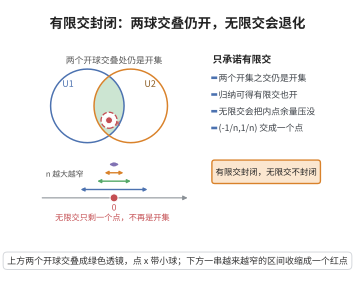

# 有限交封闭

> **一句话大白话**：开集“有限个”叠在一起取交集，得出的还是开集；但如果一口气叠无限多个，就可能不再是开集——所以只承诺“有限个”。
>
> **小例子**：在 $\mathbb{R}$ 上开区间 $(-1,1)$ 和 $(0,2)$ 的交是 $(0,1)$，仍是开集；但无穷多个区间 $(-1/n,1/n)$ 的交却缩成一个点 $\{0\}$，不再是开集。

## 介绍

**有限交封闭公理**（closure under finite intersection）规定：有限个开集的交集仍然是开集。这是拓扑空间公理的第二条，它保证了开集族在有限交运算下封闭。

## 几何直观

图意在说明：有限次取交，内点总还留有余量；一旦取可数无穷次交，余量被压到零，只剩一个点就不再是开集。

## 分析

该公理的形式化表述为：

若 U₁,U₂∈τ，则 U₁∩U₂∈τ

由归纳法可推出有限个开集的交集都是开集：若 U₁,...,Uₙ∈τ，则 ∩_{i=1}^{n} U_i ∈ τ。

注意该公理只要求对有限交封闭，不要求对无限交封闭。例如，在 ℝ 上，开区间 (-1/n,1/n) 的无限交是 {0}，但 {0} 不是开集。

## 思考过程

为什么只要求有限交封闭？在 ℝⁿ 中，任意多个开集的交集可能不再是开集（如上述例子）。如果要求无限交封闭，则开集族将大大缩小，无法刻画数学分析中需要的灵活性。

有限交封闭是拓扑学中经深思熟虑的选择：它足够强以保证有用的性质，又足够弱以允许丰富的拓扑结构。

## 证明过程

公理不需要证明。其合理性体现在：
- 有限交封闭保证了开集族在有限集合运算下封闭，这对定义连续性和极限至关重要。
- 不要求无限交封闭是为了避免"退化"情况（如单点集成为开集，导致离散拓扑）。

## 课堂问答

**老师**：拓扑为什么只要求开集对有限交封闭，而并却允许任意？

**学生**：结论先行——因为无限交会破坏开集性。公理要求 $U_1,U_2\in\tau\Rightarrow U_1\cap U_2\in\tau$，归纳得有限交仍开。反例：$\mathbb{R}$ 上 $\bigcap_{n=1}^{\infty}(-1/n,1/n)=\{0\}$ 非开集；而 $\bigcup_{n}(-1/n,1/n)=(-1,1)$ 仍是开集。

**老师（追问）**：为什么"任一内点都留有余量"能解释这种不对称？

**学生**：常见误区是以为交并地位对称。开集定义是每点有一整段邻域嵌入其中。取交时余量被逐次压缩，无限次可压到 $0$ 而退化；取并时只取更大者，余量只增不减。故对有限交封闭恰好够用又不退化。

**老师（拓展）**：若强行要求无限交封闭会怎样？

**学生**：会倾向退化成离散拓扑——每个单点集都成开集，结构过细。有限交封闭是经深思的甜点选择：强到能定义连续性与极限，弱到容得下丰富的拓扑结构。
