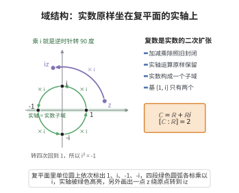

# 域结构

> **一句话大白话**：复数不但能像电脑格子里的数字一样加减乘除，而且实数的所有老规矩（如交换律、除法）在它身上照样成立，实数只是复数里老实待在直线上的那一类。
>
> **小例子**：比如 $3+2i$ 也是复数，和它一起，$7+5i$、$(1+i)+(2+3i)=3+4i$、$(2+i)\times(2-i)=5$，处处都算得开，实数 $5$ 依然是复数这个大家族的成员。

## 介绍

**域结构公理**规定：ℂ 是一个域，且 ℝ 是 ℂ 的子域。这意味着 ℂ 上定义了加法和乘法，满足域公理的所有条件，并且实数集 ℝ 及其上的运算与 ℂ 中的运算兼容。

## 几何直观

图意在说明：把实数轴嵌进复平面，实数上的加乘原样保留；再乘上一个 i，整个平面旋转 90 度，转两次就得到 -1，这正是二次扩张的几何模样。

## 分析

该公理的精确含义：

1. **ℂ 是域**：满足域公理 F1-F3（含幺交换环、乘法逆元、0≠1）。
2. **ℝ⊂ℂ**：实数集 ℝ 是 ℂ 的子集，且 ℝ 上的加法和乘法与 ℂ 上的相应运算一致，即 ℝ 在 ℂ 的加法和乘法下封闭，且 ℝ 作为子域继承了 ℂ 的域结构。

这意味着 ℂ 是 ℝ 的域扩张（field extension）。域扩张理论是抽象代数和代数数论的核心内容。

## 思考过程

ℂ 作为 ℝ 的扩张，是域扩张的最重要例子之一。在历史上，人们发现仅靠实数无法解决所有代数方程（如 x²+1=0 无实数解），因此需要将实数域扩张到更大的域。

复数域 ℂ 是 ℝ 的二次扩张（扩张次数为 2），因为 ℂ 作为 ℝ 上的向量空间是 2 维的（基为 {1,i}）。

## 证明过程

公理不需要证明。其合理性体现在：
- ℂ 中定义的加法和乘法满足域公理，这是经过验证的代数事实。
- ℝ⊂ℂ 保证了实数运算与复数运算兼容，使得复数可以视为实数的推广。
- 域结构是进行代数运算的基础，所有关于域的定理都适用于 ℂ。

## 课堂问答

**老师**：说 $\mathbb{C}$ 是域且 $\mathbb{R}$ 是它的子域，这比只说 $\mathbb{C}$ 是域多要求了什么？

**学生**：结论先行——多了运算兼容这一层。$\mathbb{C}$ 满足域公理 F1-F3（含幺交换环、非零元可逆、$0\neq1$）；同时 $\mathbb{R}\subset\mathbb{C}$，且 $\mathbb{R}$ 在 $\mathbb{C}$ 的加乘下封闭、继承同一运算。故 $\mathbb{C}$ 是 $\mathbb{R}$ 的域扩张。

**老师（追问）**：扩张次数是多少？基是什么？

**学生**：常见误区是只把 $\mathbb{R}$ 当实轴符号。作为 $\mathbb{R}$-向量空间，$\mathbb{C}$ 的基是 $\{1,i\}$，故 $[\mathbb{C}:\mathbb{R}]=2$，是二次扩张；而 $\mathbb{C}\cong\mathbb{R}[x]/(x^2+1)$ 中最小多项式 $x^2+1$ 次数也为 $2$，两者一致。

**老师（拓展）**：这条公理为何让复数成为实数的推广而非并列物？

**学生**：因为 $\mathbb{R}$ 到 $\mathbb{C}$ 的嵌入保持加乘与 $0,1$，实数运算在更大地盘里原样保留。正是这种兼容使复分析能限制到实轴得到实分析，也让 $\mathbb{C}$ 成为 $\mathbb{R}$ 的代数闭包，补全了实数域开方不全的缺陷。
