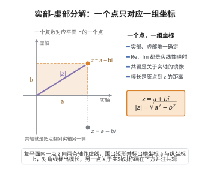

# 实部-虚部分解

> **一句话大白话**：每个复数都能像平面上画坐标一样，拆成“一条横轴上的实数”加“一条竖轴上的虚数”，而且这种拆法只有一种。
>
> **小例子**：复数 $3+4i$ 在复平面上就是横坐标 $3$、纵坐标 $4$ 的那个点（$(3,4)$）；它永远只拆成 $3+4i$，不会同时又是 $5+i$——一个点只对应一组坐标。

## 介绍

**实部-虚部分解公理**规定：每个复数 z∈ℂ 可以唯一地表示为 z=a+bi，其中 a,b∈ℝ。a 称为 z 的实部（Re(z)），b 称为 z 的虚部（Im(z)）。

## 几何直观

图意在说明：复数与平面上的点一一对应，横向读数是实部、纵向读数是虚部；翻转实轴得到共轭，原点到该点的长度就是模。

## 分析

该公理的形式化表述为：

∀z∈ℂ，∃!a,b∈ℝ，s.t. z = a + bi

其中 i 是虚数单位。这一定义了复数的标准表示，也是 ℂ 作为 ℝ-向量空间具有基 {1,i} 的体现。

实部和虚部定义了映射 Re:ℂ→ℝ 和 Im:ℂ→ℝ，它们是 ℝ-线性映射。由此可以定义复数的共轭：z̄ = a-bi，以及模长：|z| = √(a²+b²)。

## 思考过程

将复数表示为 a+bi 的形式是 Gauss 在 19 世纪初提出的。Gauss 还给出了复数的几何解释：将复数 (a,b) 对应到平面上的点，从而建立了复平面（Argand 图）。

唯一性保证是重要的：如果 z=a+bi=c+di，则 a=c 且 b=d。这确保了复数的代数运算具有良定义的性质。

## 证明过程

公理不需要证明。其合理性体现在：
- 实部-虚部分解提供了复数的标准表示，使得复数的加法和乘法有明确的计算规则。
- 唯一性保证了复数的代数运算不依赖于表示方式。
- 这种分解将复数与平面几何联系起来，为复分析和几何应用奠定了基础。

## 课堂问答

**老师**：复数的表示 $z=a+bi\ (a,b\in\mathbb{R})$ 为什么强调唯一？

**学生**：结论先行——唯一性保证运算良定义、坐标不歧义。形式化 $\forall z\in\mathbb{C},\ \exists!\,a,b\in\mathbb{R},\ z=a+bi$，等价于 $\{1,i\}$ 是 $\mathbb{C}$ 作为 $\mathbb{R}$-向量空间的基，$\dim_{\mathbb{R}}\mathbb{C}=2$。由此 $\mathrm{Re},\mathrm{Im}$ 为 $\mathbb{R}$-线性映射，可定义共轭与模。

**老师（追问）**：若某个复数的坐标不唯一，后果是什么？

**学生**：常见误区是只把 $a+bi$ 当记号。若 $a+bi=c+di$ 而 $(a,b)\neq(c,d)$，则 $(a-c)=(d-b)i$ 使一非零实数等于纯虚数，加法与共轭运算将无良定义，"实部"变成多值，代数运算失稳。

**老师（拓展）**：这一分解如何连接复分析与几何？

**学生**：把 $z\mapsto(a,b)$ 映入复平面（Argand 图），加法成为向量平移、乘 $i$ 成为旋转 $90^\circ$。实部-虚部分解因此是把复数从记号提升为平面几何对象的桥梁，也是 $\mathbb{C}\cong\mathbb{R}^2$ 的代数表述。
