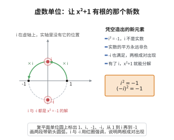

# 虚数单位

> **一句话大白话**：你发明一个“平方是 $-1$”的数 $i$，它开不了实数那扇门，却专门用来让像 $x^2=-1$ 这样原来没解的方程也能有答案。
>
> **小例子**：方程 $x^2=-1$ 在实数里无解，但令 $x=i$ 就满足 $i^2=-1$；顺带 $(-i)^2=-1$，所以 $i$ 和 $-i$ 都是解，而 $3i$ 表示虚部是 $3$ 的纯虚数。

## 介绍

**虚数单位公理**规定：存在虚数单位 i∈ℂ，使得 i²=-1。虚数单位是复数域区别于实数域的最核心元素，也是复数域中所有"非实数"元素的来源。

## 几何直观

图意在说明：i 站在虚轴上，实数的平方非负所以它无处安放；乘 i 转两圈把 1 送到 -1，正好是 i 平方等于 -1 的几何版本。

## 分析

该公理的形式化表述为：

∃i∈ℂ，i² = -1

其中 i 是虚数单位，满足 i² = -1。注意 i 不是实数（因为实数的平方非负），因此 i 是 ℂ 中真正"新"的元素。

从 i 出发，可以生成所有复数：a+bi（a,b∈ℝ）。虚数单位 i 不是唯一的，-i 也满足 (-i)² = (-1)²·i² = i² = -1。

## 思考过程

为什么需要虚数单位？方程 x²+1=0 在 ℝ 中无解，为了求解该方程，必须引入新的数 i。在 16 世纪，Cardano 和 Bombelli 在解三次方程时首次使用了复数形式。Euler 系统地引入了符号 i，并给出了著名的公式 e^(iθ) = cosθ + i sinθ。

虚数单位 i 的引入使代数基本定理成立：每个非常数复系数多项式在 ℂ 中都有根。

## 证明过程

公理不需要证明。其合理性体现在：
- i²=-1 是复数域的核心定义，决定了 ℂ 的代数结构。
- 虚数单位的存在使得所有代数方程在 ℂ 中都可解。
- 从域扩张的角度看，ℂ ≅ ℝ[x]/(x²+1)，其中 x²+1 的根就是虚数单位 i。

## 课堂问答

**老师**：引入满足 $i^2=-1$ 的 $i$，而 $i\notin\mathbb{R}$，这样凭空造数合法吗？

**学生**：结论先行——合法且必要，可用商环严格构造。$\mathbb{C}\cong\mathbb{R}[x]/(x^2+1)$，其中 $x^2+1$ 在 $\mathbb{R}$ 上不可约，其根即 $i$。公理 $\exists i\in\mathbb{C},\ i^2=-1$；因实数的平方非负，$i$ 确是 $\mathbb{C}$ 中新元素，且 $\{a+bi\}$ 构成域。

**老师（追问）**：$i$ 唯一吗？代数基本定理为何依赖它？

**学生**：常见误区是以为 $i$ 唯一。$(-i)^2=(-1)^2 i^2=-1$，故 $i$ 与 $-i$ 都是 $x^2+1$ 的根，二者共轭不可分辨。正因引入了这个根，$\mathbb{C}$ 成为代数闭域：任意非常数复系数多项式在 $\mathbb{C}$ 中都有根。

**老师（拓展）**：Euler 公式如何把 $i$ 与几何统一？

**学生**：$e^{i\theta}=\cos\theta+i\sin\theta$ 把虚指数变成单位圆上的旋转，$\theta=\pi$ 得 $e^{i\pi}+1=0$。这说明 $i$ 不只是解方程的符号，更是平面上旋转 $90^\circ$ 的算子，横跨代数、分析与几何。
