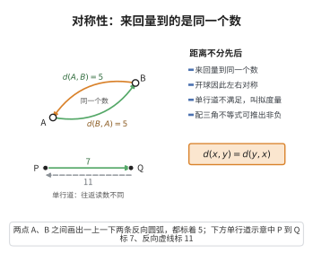

# 对称性

> **一句话大白话**：距离是“量尺子”，不分谁先谁后——从你家到学校，和从学校回你家，路程一样长。
>
> **小例子**：平面上 $A(0,0)$ 到 $B(3,4)$ 是 $\sqrt{3^2+4^2}=5$，反向 $B$ 到 $A$ 还是 $5$，即 $d(A,B)=d(B,A)=5$——来回一个价。

## 介绍

**对称性公理**（symmetry）规定：度量空间中从 x 到 y 的距离等于从 y 到 x 的距离。这是距离概念的直观性质。

## 几何直观

图意在说明：A 到 B 与 B 到 A 走的是同一段距离；单行道那种往返不等的读法不满足这条公理，只能叫拟度量。

## 分析

该公理的形式化表述为：

∀x,y∈X，d(x,y) = d(y,x)

对称性意味着距离函数不依赖于方向：从 A 到 B 的距离与从 B 到 A 的距离相同。在大多数日常场景中，这是自然成立的。

## 思考过程

对称性在大多数距离概念中都是自然的（如欧几里得距离、曼哈顿距离等）。但也有一些非对称的"距离"概念，如单行道网络中的行车距离、某些经济学中的偏好距离等。这些非对称度量被称为"拟度量"（quasimetric）。

在数学中，对称性保证了度量诱导的拓扑具有一致的性质。

## 证明过程

公理不需要证明。其合理性体现在：
- 对称性是欧几里得空间中距离的基本性质：|x-y| = |y-x|。
- 对称性使得度量空间中的许多讨论更加简洁，如开球的定义不再依赖于方向。
- 对称性保证了度量空间诱导的拓扑具有良定义的邻域基。

## 课堂问答

**老师**：$d(x,y)=d(y,x)$ 看似天经地义，为什么度量公理还要明写？有无反例？

**学生**：结论先行——因为确有不满足者，且对称性影响拓扑良定义。形式化 $\forall x,y,\ d(x,y)=d(y,x)$，即距离与方向无关。反例是单行道行车距离、有向路网最短路，其距离不对称，称为拟度量。

**老师（追问）**：失去对称性会付出什么代价？

**学生**：常见误区是以为只是少条公式。没有对称性时 $d(x,x)\leq d(x,y)+d(y,x)$ 这类论证失效，开球不再关于中心对称、邻域基可能双向不同，诱导拓扑须改用单侧开球，讨论显著复杂化。

**老师（拓展）**：对称性与另外两条度量公理如何配合？

**学生**：对称性加三角不等式是证明非负性的关键：$0=d(x,x)\leq d(x,y)+d(y,x)=2d(x,y)$，也让开球定义不依赖方向、保证 $d(x,y)=0$ 左右一致。它使度量空间诱导的拓扑具有良定义的邻域基，是三条公理协同的枢纽。
