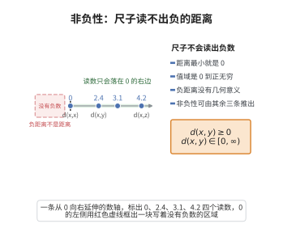

# 非负性

> **一句话大白话**：两点之间的距离永远不会是负数——尺子量出来要么是 0（同一点），要么是正数，没有“负的距离”这回事。
>
> **小例子**：数轴上 $3$ 到 $7$ 的距离是 $|7-3|=4$，$3$ 到 $3$ 是 $0$；无论怎么取，$d(x,y)\ge 0$ 恒成立，永远不会得到 $-4$ 这种读数。

## 介绍

**非负性公理**（non-negativity）规定：度量空间中任意两点之间的距离是非负的。这是距离概念最基本的要求。

## 几何直观

图意在说明：所有距离读数都落在 0 右侧的射线上，零只属于同一点；负的一侧根本没有刻度，距离函数的值域是 0 到正无穷。

## 分析

该公理的形式化表述为：

∀x,y∈X，d(x,y) ≥ 0

其中 d 是度量空间 X 上的距离函数。

非负性是"距离"的自然属性：两点之间的距离不可能为负数。它可以由同一性、对称性和三角不等式共同推出，因此是冗余条款；教材仍常明确列出，是为了直接呈现距离的非负含义，而不是因为四条公理彼此独立。

## 思考过程

在日常生活中，距离从来不会是负数。从数学角度看，非负性保证了距离函数的值域是 [0,∞)，这使得我们可以用距离来比较"接近"程度。

## 证明过程

作为定义中明确列出的条款，非负性无需另行假设即可由其余三条推出。对任意 $x,y\in X$，由同一性、三角不等式和对称性可得
$$0=d(x,x)\leq d(x,y)+d(y,x)=2d(x,y),$$
故 $d(x,y)\geq0$。因此非负性并非独立公理，而是冗余但直观常用的规范条款。

## 课堂问答

**老师**：度量公理已含同一性与三角不等式，$d(x,y)\geq0$ 还需要单列吗？

**学生**：结论先行——逻辑上它可由其余三条推出，但习惯单列以保持定义直观。推导：由同一性 $d(x,x)=0$，由三角不等式 $0=d(x,x)\leq d(x,y)+d(y,x)$，再用对称性 $d(y,x)=d(x,y)$ 得 $0\leq2d(x,y)$，故 $d(x,y)\geq0$。因此非负性并非独立公理。

**老师（追问）**：既然如此，为何教材仍列出它？

**学生**：常见误区是以为列出的每条都独立。度量公理常写成四条（非负、同一、对称、三角）以直接呈现距离语义；其中非负可由其余三条推出，属冗余但直观常用的条款，不能称四条相互独立。

**老师（拓展）**：去掉非负性会得到什么？

**学生**：若只是从列表中删去非负性而保留其余三条，得到的定义完全等价，不会允许负值。只有另行删改其余条款、构造允许负值的函数时，$d$ 才不再对应通常的距离直觉。非负性虽冗余，仍是方便的语义锚点。

## 相关条目

- [16-度量空间公理索引](index.md)
- [公理体系总索引](../index.md)
