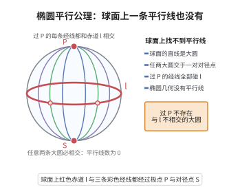

# 椭圆平行公理

> **一句话大白话**：在椭圆（球面）世界里，过线外一点**一条平行线都画不出来**——任何两条“直线”总会碰到一起。
>
> **小例子**：想一想地球表面，经线都是“直线”（大圆），你把赤道当一条线、在北半球取个点，过它画的大圆一定会再绕回来跟赤道相交；“（这个点上）平行线数量”是 $0$，比起欧氏的 $1$ 和双曲的“无数条”，完全反着来。

## 介绍

**椭圆平行公理**（Elliptic Parallel Axiom）是椭圆几何（也称球面几何或 Riemann 几何）的核心公理。它规定：过"直线外一点"，不存在与该直线不相交的直线；等价地，任意两条"直线"都相交。

## 几何直观

图意在说明：球面的直线是大圆，任意两条必交于一对对径点，所以过 P 根本找不到不碰 l 的直线。

## 分析

椭圆平行公理的形式化表述为：

给定"直线" l 和不在 l 上的点 P，不存在通过 P 且与 l 不相交的"直线"。

在球面几何中，"直线"被解释为大圆（球面上过球心的平面与球面的交线）。任意两个大圆都相交于一对对径点。因此，在椭圆几何中，没有平行线的概念。

## 思考过程

椭圆几何由 Riemann 在 1854 年的著名演讲《论几何学之基础假设》中提出。Riemann 将几何学从欧几里得的框架中解放出来，提出了广义的黎曼几何。在椭圆几何中，三角形内角和大于 180°，且直线的长度是有限的。

在球面几何中需要注意：球面上的"直线"（大圆）是闭合的，且两点不一定确定唯一的大圆（对径点之间有无数个大圆）。

## 证明过程

公理不需要证明。其合理性体现在：
- 球面几何（椭圆几何的模型）在球面三角学、导航和天文学中有着悠久的历史和实际应用。
- 椭圆几何是曲率为正的常曲率空间的几何，在广义相对论中用于描述正曲率时空。
- 椭圆几何的自洽性可以通过球面模型验证。

## 课堂问答

**老师**："过直线外一点没有平行线"，这迫使几何发生什么变化？

**学生**：任意两条"直线"必相交。在球面模型中"直线"是大圆，两两相交于一对对径点；三角形内角和大于 $180^\circ$，且直线长度有限。

**老师（追问）**：球面模型有没有需要注意的瑕疵？

**学生**：有。大圆闭合，且一对对径点之间不唯一确定大圆，严格说球面是"二重椭圆几何"的模型；若要保住"任两点确定唯一直线"，需把对径点粘合，得到射影型的椭圆几何。

**老师（拓展）**：它的理论地位与应用如何？

**学生**：Riemann（1854）据此把几何从欧氏框架中解放出来，它对应曲率为正的常曲率空间；球面三角学用于导航与天文，广义相对论以正曲率时空为其建模。常见误区是以为它违反欧氏直觉就是"循环矛盾"——它自洽，只是换了平行公理。
