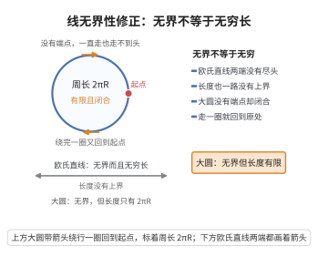

# 线无界性修正

> **一句话大白话**：欧氏里的直线又长又没尽头，椭圆里的“直线”（大圆）走一圈就回到原点——**没头没尾，但长度是有限**的。
>
> **小例子**：在地球上沿赤道（大圆）一直走，永远碰不到“终点”，但绕完一圈只有 $2\pi R$ 那么长，C=2πR 有限可数——这就是“无界却有限”的直观。

## 介绍

**线无界性修正**（Line Unboundedness Revision）是椭圆几何中的一条重要修正。在欧几里得几何中，直线是无限延伸的（无界且无穷长）。但在椭圆几何（球面几何）中，"直线"（大圆）是有限但无界的——它没有端点，但长度是有限的。

## 几何直观

图意在说明：大圆没有端点却闭合成环，长度只有 2πR；直线无端又无界，这两件事在球面上被拆开了。

## 分析

该修正的精确含义：

在欧几里得几何中，直线具有以下性质：
- 无界性（unboundedness）：直线可以向两个方向无限延伸。
- 无穷性（infinite length）：直线的长度是无限的。

在椭圆几何中：
- 大圆是"无边"的（boundaryless）：没有起点和终点，沿大圆走一圈会回到起点。
- 大圆是**有限**的：其周长是有限的（2πR，其中 R 是球面半径）。
- 大圆是**闭合**的：沿大圆走一圈后回到起点。

## 思考过程

欧几里得几何中"直线是无限的"这一假设在球面几何中不再成立。球面上的大圆是有限的，但它是"无边的"——没有端点。这与"线"的直观理解不同，但却是自洽的。

Riemann 在推广几何学时，区分了"无界"（unbounded）和"无穷"（infinite），指出空间可以是无界但不无穷的（如球面）。

## 证明过程

公理不需要证明。其合理性体现在：
- 在地球表面，经线（大圆）是有限的，但沿经线行走不会遇到边界。
- 有限无边的空间在广义相对论中具有重要应用（如宇宙的拓扑结构可能是有限无边的）。
- 这条修正使得椭圆几何在逻辑上自洽，且具有丰富的几何结构。

## 课堂问答

**老师**：欧氏里"直线无限长"这条直觉，在椭圆几何中如何被修正？

**学生**：修正为"无界但有限"：大圆没有端点，可以一直走下去，但长度有限，为 $C=2\pi R$，而且是闭合的。

**老师（追问）**："无界"与"无穷"是一回事吗？

**学生**：不是。Riemann 明确区分二者：空间可以无界而不无穷，球面就是例子。只有欧氏直线才同时无界且无穷长。

**老师（拓展）**：这个区分为什么重要？

**学生**：它使"有限无边"的宇宙拓扑在广义相对论中成为可讨论的模型。常见误区是把"找不到端点"等同于"长度无限"——圆周长就是反例。
