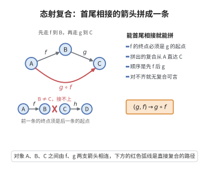

# 态射复合

> **一句话大白话**：一条箭头能接着另一条箭头连下去——只要前一条的终点正好是后一条的起点，就能把两条“拼”成一条新箭头。
>
> **小例子**：箭头 $f:A\to B$ 表示从 A 指向 B，箭头 $g:B\to C$ 表示从 B 指向 C，那么 $g\circ f:A\to C$ 就是“先走 f 再走 g”拼成的一条箭头，好比先到 B 站再到 C 站一气呵成。

## 介绍

**态射复合公理**（Composition of Morphisms）是范畴论公理的第一条。它规定：对任意对象 A,B,C，存在一个复合映射 ∘:Hom(B,C)×Hom(A,B)→Hom(A,C)，将态射 f:A→B 和 g:B→C 复合为态射 g∘f:A→C。

## 几何直观

图意在说明：只要前一支箭头的终点正好是后一支的起点，两条箭头就能拼成一条从 A 直达 C 的新箭头。

## 分析

该公理的形式化表述为：

∀A,B,C∈Ob(𝒞)，复合运算 ∘: Hom(B,C) × Hom(A,B) → Hom(A,C)

记为 (g,f) ↦ g∘f

其中：
- f:A→B 是态射（从 A 到 B）
- g:B→C 是态射（从 B 到 C）
- g∘f:A→C 是复合态射（从 A 到 C）

态射复合是范畴论中最基本的操作，它将态射的"连接"形式化。

## 思考过程

态射复合是函数复合的抽象。在集合范畴中，函数复合是自然的：如果 f:A→B 和 g:B→C 是函数，则 g∘f:A→C 是它们的复合。范畴论将这一概念推广到任意数学结构。

态射复合直观地对应于"先做 f，再做 g"的操作顺序。

## 证明过程

公理不需要证明。其合理性体现在：
- 态射复合是范畴论的核心操作，没有它，态射之间无法建立联系。
- 在所有具体范畴中，态射复合对应于结构保持映射的复合，是自然且有意义的。
- 态射复合的存在使得范畴成为一个"有向图"加上代数结构。

## 课堂问答

**老师**：态射复合公理说的是什么？为什么它是范畴论的第一条？

**学生**：它保证任意两条"能首尾相接"的态射都能拼成一条新态射。形式化地，对任意 $A,B,C\in\mathrm{Ob}(\mathcal{C})$，存在复合映射 $\circ:\mathrm{Hom}(B,C)\times\mathrm{Hom}(A,B)\to\mathrm{Hom}(A,C)$，$(g,f)\mapsto g\circ f$。没有它，范畴就退化成一张没有"连接运算"的有向图，态射之间无法建立联系，所以它必须排在第一位。

**老师（追问）**：$f:A\to B$ 与 $h:C\to D$，能复合出 $h\circ f$ 吗？那 $f\circ f$ 呢？

**学生**：$h\circ f$ 一般不能——复合要求中间对象对齐，即一个态射的终点须是另一个的起点。$h$ 从 $C$ 出发，而 $f$ 止于 $B$，除非 $B=C$ 否则无定义。至于 $f\circ f$，只有当 $B=A$（即 $f$ 是自同态 $f:A\to A$）时才有意义。顺序也易错：$g\circ f$ 表示"先 $f$ 后 $g$"，$f$ 写在右、$g$ 写在左。

**老师（拓展）**：集合范畴里复合恰好是函数复合，这说明了什么？

**学生**：在 $\mathbf{Set}$ 中对象是集合、态射是函数，$\mathrm{Hom}(A,B)$ 就是全部函数 $A\to B$，定义 $(g\circ f)(x)=g(f(x))$ 恰是逐点复合。这说明范畴论是把函数复合抽象成公理，同一套语言可套用到群、拓扑空间、偏序集上：偏序集里 $\mathrm{Hom}(a,b)$ 至多一个元素（$a\le b$ 时非空），复合就是不等式的传递。
