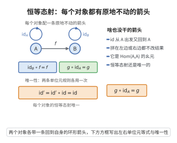

# 恒等态射

> **一句话大白话**：每个对象都配一条“啥也没干”的箭头——从它出发回到它自己，跟任何箭头拼接都不动别人。
>
> **小例子**：对象 A 上的恒等态射 $\mathrm{id}_A:A\to A$ 就像“站在原地不动”，于是 $g\circ \mathrm{id}_A=g$ 且 $\mathrm{id}_B\circ f=f$，好比“+0”或“×1”一样，拼上去结果不变。

## 介绍

**恒等态射公理**（Identity Morphisms）是范畴论公理的第三条。它规定：每个对象 A 都存在一个恒等态射 idA:A→A，使得该态射在复合中起到单位元的作用。

## 几何直观

图意在说明：每个对象都有一条原地不动的箭头，拼在复合的左边或右边都不改变结果，而且这样的箭头只有一个。

## 分析

该公理的形式化表述为：

∀A∈Ob(𝒞)，∃idA∈Hom(A,A)，使得：

∀f:A→B，idB∘f = f
∀g:C→A，g∘idA = g

恒等态射是范畴中每个对象的"身份标识"，它在复合中既不改变对象也不改变态射。恒等态射是唯一的（若存在两个恒等态射，则它们必然相等）。

## 思考过程

恒等态射是函数 id(x)=x 的抽象。在集合范畴中，恒等函数将每个元素映射到自身。在群范畴中，恒等群同态将每个元素映射到自身。

恒等态射的存在保证了范畴具有"单位元"，使得态射的复合形成一个广义的幺半群结构。

## 证明过程

公理不需要证明。其合理性体现在：
- 恒等态射在范畴论中扮演着乘法单位元的角色，是范畴结构完整性的必要条件。
- 在所有具体范畴中，恒等映射是自然存在的结构保持映射。
- 恒等态射是定义同构、函子、自然变换等概念的基础。例如，f:A→B 是同构当且仅当存在 g:B→A 使得 g∘f=idA 且 f∘g=idB。

## 课堂问答

**老师**：恒等态射公理说的是什么？

**学生**：每个对象 $A$ 都存在一个自同态 $\mathrm{id}_A:A\to A$，它在复合中充当单位元：对任意 $f:A\to B$ 有 $\mathrm{id}_B\circ f=f$，对任意 $g:C\to A$ 有 $g\circ\mathrm{id}_A=g$。它与结合律一起，使 $\mathrm{Hom}(A,A)$ 成为以 $\mathrm{id}_A$ 为幺元的幺半群。

**老师（追问）**：$\mathrm{id}_A$ 唯一吗？请给出证明。

**学生**：唯一。设 $\mathrm{id}_A'$ 也是 $A$ 上的恒等态射，把两条单位元规则各用一次：$\mathrm{id}_A'=\mathrm{id}_A'\circ\mathrm{id}_A=\mathrm{id}_A$——第一步用 $\mathrm{id}_A$ 是右单位元，第二步用 $\mathrm{id}_A'$ 是左单位元。故每个对象的恒等态射唯一，可放心记作 $\mathrm{id}_A$。

**老师（拓展）**：恒等态射是怎样引出"同构"的？

**学生**：称 $f:A\to B$ 为同构，是指存在 $g:B\to A$ 使 $g\circ f=\mathrm{id}_A$ 且 $f\circ g=\mathrm{id}_B$，记 $g=f^{-1}$。可见同构的定义完全由 $\mathrm{id}$ 与复合给出。常见误区：在 $\mathbf{Set}$ 里单射有左逆、满射（选择公理下）有右逆，但只有两侧逆同时存在才等价于同构；在一般范畴中更不能默认"单态射+满态射=同构"。
