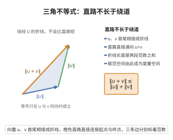

# 三角不等式

> **一句话大白话**：走“绕弯”的路永远不短于抄直路，两段长度加起来总不会比最后的总长度小。
>
> **小例子**：向量 $u=(1,0)$、$v=(0,1)$，则 $\|u+v\|=\|(1,1)\|=\sqrt{2}\approx1.41$，而 $\|u\|+\|v\|=1+1=2$，确实 $1.41\le 2$——这就是“两边之和大于第三边”。

## 介绍

**三角不等式**（Triangle Inequality）是赋范线性空间公理中最重要的第三条。它规定：两个向量之和的范数不超过这两个向量的范数之和。这是一条基本的"次可加性"条件。

## 几何直观

图意在说明：先走 u 再走 v 的折线长度是两段范数之和，永远不小于直接指向 u+v 的直路。

## 分析

该公理的形式化表述为：

∀u,v∈V，‖u+v‖ ≤ ‖u‖ + ‖v‖

三角不等式是范数定义中最重要的条件，它保证了范数诱导的距离 d(u,v)=‖u-v‖ 满足度量空间的三角不等式。通过三角不等式，可以证明：

- 范数是连续函数。
- 赋范空间中的加法运算是连续的。
- 赋范空间中的收敛性具有良好性质。

## 思考过程

三角不等式来源于欧几里得几何中的"三角形两边之和大于第三边"。在一般的赋范空间中，虽然没有显式的几何三角形，但三角不等式仍然是最重要的分析工具之一。

三角不等式是分析学中几乎所有估计的基础，包括逼近理论中的误差估计、数值分析中的收敛性分析、算子理论中的范数估计等。

## 证明过程

公理不需要证明。其合理性体现在：
- 三角不等式是"长度"概念的核心特征，反映了距离的次可加性。
- 三角不等式保证了赋范空间自动成为度量空间，从而可以应用度量空间的所有理论。
- 没有三角不等式，赋范空间将无法建立起有效的极限和收敛理论，泛函分析的核心工具（如 Banach 不动点定理、开映射定理等）将无法建立。

## 课堂问答

**老师**：三角不等式公理说的是什么？

**学生**：对所有 $u,v$ 有 $\|u+v\|\le\|u\|+\|v\|$。它是范数三条公理中分析味道最重的一条，等价地让 $d(u,v)=\|u-v\|$ 满足度量的三角不等式 $d(u,w)\le d(u,v)+d(v,w)$。

**老师（追问）**：由它能推出反向的估计 $\big|\|u\|-\|v\|\big|\le\|u-v\|$ 吗？

**学生**：能。由 $\|u\|=\|(u-v)+v\|\le\|u-v\|+\|v\|$ 整理得 $\|u\|-\|v\|\le\|u-v\|$，交换 $u,v$ 又得 $\|v\|-\|u\|\le\|u-v\|$，合起来即 $\big|\|u\|-\|v\|\big|\le\|u-v\|$。由此立刻得到范数关于 $v$ 是 $1$-Lipschitz 连续，特别地 $v_n\to v$ 蕴含 $\|v_n\|\to\|v\|$。

**老师（拓展）**：为什么没有它，泛函分析就搭不起来？

**学生**：三角不等式使赋范空间自动成为度量空间，于是极限、Cauchy 列、完备性才有定义，才能谈 Banach 空间与不动点、开映射等定理。它还给出最常用的估计手法：把和式各项先分别估范数再相加。常见误区：等号何时成立并不总能只看共线——在一般赋范空间需先具备内积结构（严格凸），才能断定 $\|u+v\|=\|u\|+\|v\|$ 当且仅当两者同向。
