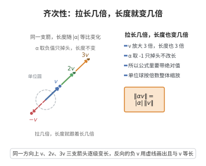

# 齐次性

> **一句话大白话**：把向量“拉长几倍”，它的长度就跟着变长几倍；方向和大小随标量按比例同步缩放。
>
> **小例子**：若 $v=(1,2)$，则 $\|v\|=\sqrt5$；把它放大 3 倍得 $3v=(3,6)$，长度 $\|3v\|=\sqrt{45}=3\sqrt5=|3|\cdot\|v\|$。而把方向反过来 $(-1)v$ 时，长度不变，即 $\|{-}v\|=\|v\|$。

## 介绍

**齐次性公理**（Homogeneity / Absolute Scalability）是赋范线性空间公理的第二条。它规定：标量乘以向量的范数等于标量的绝对值乘以向量的范数。这条公理保证了范数对标量乘法具有齐次性。

## 几何直观

图意在说明：把向量放大 k 倍，长度就精确放大 |k| 倍；标量取负只是掉头，长度完全不变。

## 分析

该公理的形式化表述为：

∀α∈𝔽，∀v∈V，‖αv‖ = |α|·‖v‖

其中 |α| 是标量 α 的绝对值（实数域中为绝对值，复数域中为模）。

齐次性意味着：
- 将向量拉伸 α 倍，其范数也拉伸 |α| 倍。
- ‖-v‖ = ‖v‖（取 α=-1）。
- 范数关于标量乘法是"绝对齐次"的。

## 思考过程

齐次性来源于欧几里得空间中向量的标量乘法性质：|αv| = |α|·|v|。在一般的赋范空间中，齐次性保证了范数在标量乘法下的可预测行为。

齐次性在分析中非常重要：它保证了级数收敛、线性算子的有界性等概念中关于标量乘法的良好性质。

## 证明过程

公理不需要证明。其合理性体现在：
- 齐次性是"长度"概念的直观要求：将向量拉伸 k 倍，其长度也应变为 k 倍。
- 齐次性保证了范数诱导的度量满足 d(αu,αv)=|α|·d(u,v)。
- 在函数空间中，齐次性保证了‖f‖的缩放与函数值的缩放一致。

## 课堂问答

**老师**：齐次性公理说的是什么？为什么用 $|\alpha|$ 而不是 $\alpha$？

**学生**：它规定 $\|\alpha v\|=|\alpha|\cdot\|v\|$，对任意标量 $\alpha$ 与向量 $v$ 成立。必须取绝对值（复域上取模），否则令 $\alpha=-1$ 就得到 $\|-v\|=-\|v\|$，与长度非负矛盾。取绝对值后立刻推出 $\|-v\|=\|v\|$，即长度对取反不变。

**老师（追问）**：$\alpha=0$ 时这条公理交代了什么？

**学生**：因为 $0\cdot v=0$，于是 $\|0\|=|0|\cdot\|v\|=0$，即零向量的范数为 $0$。再结合正定性，反过来 $\|v\|=0\Rightarrow v=0$，正负两向合起来正好刻画零向量。这也提示：齐次性里的标量必须能取 $0$，所以实数、复数域乃至一般域都适用；若错写成"仅对 $\alpha>0$ 成立"，就丢了负标量这一半信息。

**老师（拓展）**：齐次性给度量带来了什么？

**学生**：令 $d(u,v)=\|u-v\|$，齐次性配合平移给出 $d(\alpha u,\alpha v)=\|\alpha(u-v)\|=|\alpha|\,\|u-v\|=|\alpha|\,d(u,v)$，即度量关于标量乘法是等比的。正是这条性质让范数与原点的距离相容：单位球 $\{v:\|v\|\le 1\}$ 是一致放缩的凸集。注意齐次性与三角不等式缺一不可——若只有这两条而无正定性，得到的只是半范数。
