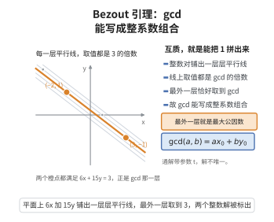

# Bezout 引理

> **一句话大白话**：两个数最大的公因数，总能靠这两个数"乘开、加加减减"凑出来。
>
> **小例子**：$\gcd(6,15)=3$，而 $6\times(-2)+15\times1=3$，正好把公因数 3 用 6 和 15 拼出来了。

## 介绍

Bezout 引理（也称 Bézout 恒等式）是数论中一个基础而深刻的结论：对于任意不全为零的整数 $a$ 和 $b$，存在整数 $x$ 和 $y$，使得 $ax + by = \gcd(a, b)$。这一引理揭示了最大公因数的线性表示性质，是数论中许多重要定理（如 Euclid 引理、算术基本定理）的证明基石。它在密码学（RSA 算法中模逆元的存在性证明）、丢番图方程求解以及模运算中都有广泛应用。

## 几何直观

图意在说明：所有 6x + 15y 的取值只能在等距的平行线上排队，正整数里最靠里的那一层恰好是 3，也就是 gcd(6, 15)；所以 gcd 一定能写成 a、b 的整系数组合，且解并不唯一。

## 分析

**前置依赖**：辗转相除法。

**定理内容**：对任意不全为零的整数 $a, b$，存在整数 $x, y$ 使得 $ax + by = \gcd(a, b)$。

**数学内涵**：
- Bezout 引理的核心是：最大公因数不仅是 $a$ 和 $b$ 的最大公因数，而且可以表示为 $a$ 和 $b$ 的整系数线性组合。
- 特别地，当 $a$ 和 $b$ 互质时（$\gcd(a, b) = 1$），存在 $x, y$ 使得 $ax + by = 1$。这意味着"互质"等价于"1 可表示为 $a$ 和 $b$ 的线性组合"。
- 整数 $x, y$ 不是唯一的——事实上存在无穷多组解，通解为 $x = x_0 + \frac{b}{\gcd(a,b)}t,\ y = y_0 - \frac{a}{\gcd(a,b)}t$，其中 $t \in \mathbb{Z}$。

**证明策略**：
- 反向代入法：利用辗转相除法的计算过程，从最后一个等式开始反向代入，逐步消去余数，最终得到 $a$ 和 $b$ 的线性组合。
- 构造法：考虑集合 $S = \{ax + by \mid x, y \in \mathbb{Z}, ax + by > 0\}$，证明 $S$ 中的最小元就是 $\gcd(a, b)$。

## 思考过程

Bezout 引理的发现可以追溯到辗转相除法。在辗转相除法的过程中，我们得到一系列等式：

$$
\begin{aligned}
a &= bq_1 + r_1 \\
b &= r_1q_2 + r_2 \\
r_1 &= r_2q_3 + r_3 \\
&\ \vdots \\
r_{n-1} &= r_nq_{n+1} + 0
\end{aligned}
$$

其中最后一个非零余数 $r_n = \gcd(a, b)$。每个等式都可以写成"余数 = 被除数 - 商 × 除数"。如果我们从最后一个等式开始，将 $r_n$ 表示为 $r_{n-1}$ 和 $r_{n-2}$ 的线性组合，然后逐步代入前一式，最终就能将 $\gcd(a, b)$ 表示为 $a$ 和 $b$ 的线性组合。

另一种更优雅的视角是考虑 $a$ 和 $b$ 的所有整系数线性组合构成的集合 $S$。这个集合在加法下封闭，且包含正数。选取 $S$ 中最小的正数 $d$，可以证明 $d$ 整除 $a$ 和 $b$，且 $a$ 和 $b$ 的任何公因数都整除 $d$，因此 $d = \gcd(a, b)$。

## 证明过程

**定理**：对任意不全为零的整数 $a, b$，存在整数 $x, y$ 使得 $ax + by = \gcd(a, b)$。

**证明**：

不妨设 $a, b$ 为正整数（若为负，可调整符号）。

考虑集合

$$
S = \{ax + by \mid x, y \in \mathbb{Z},\ ax + by > 0\}
$$

由于 $a \cdot 1 + b \cdot 0 = a > 0$（若 $a > 0$），故 $S$ 非空。由良序原理，$S$ 有最小元 $d$。设 $d = ax_0 + by_0$。

**第一步**：证明 $d \mid a$ 且 $d \mid b$。

由带余除法，$a = dq + r$，$0 \leq r < d$。则

$$
r = a - dq = a - (ax_0 + by_0)q = a(1 - qx_0) + b(-qy_0) \in S \cup \{0\}
$$

若 $r > 0$，则 $r \in S$ 且 $r < d$，与 $d$ 的最小性矛盾。故 $r = 0$，即 $d \mid a$。同理可证 $d \mid b$。

**第二步**：证明 $d = \gcd(a, b)$。

设 $c$ 是 $a$ 和 $b$ 的任意公因数，即 $c \mid a$ 且 $c \mid b$。则 $c \mid (ax_0 + by_0) = d$。故 $c \leq d$。

由第一步知 $d$ 是 $a$ 和 $b$ 的公因数，且 $a$ 和 $b$ 的任意公因数都整除 $d$，因此 $d$ 是最大公因数，即 $d = \gcd(a, b)$。

故存在整数 $x_0, y_0$ 使得 $ax_0 + by_0 = \gcd(a, b)$。$\square$

---

**推论**：$a$ 和 $b$ 互质当且仅当存在整数 $x, y$ 使得 $ax + by = 1$。

## 课堂问答

**老师**：若 $a,b$ 不全为零，凭什么说 $\gcd(a,b)$ 一定能写成 $ax+by$ 的形式？先讲清这句话的实质。

**学生**：实质是"最大公因数属于 $a,b$ 的整系数线性组合集"。取集合 $S=\{ax+by>0\}$，设其最小元为 $d=ax_0+by_0$，再用带余除法令 $a=dq+r$，则 $r=a(1-qx_0)+b(-qy_0)$；若 $r>0$ 就与 $d$ 的最小性矛盾，故 $d\mid a$，同理 $d\mid b$。

**老师（追问）**：只证出 $d$ 是公因数还不够，凭什么它是"最大"的？

**学生**：因为任一公因数 $c$ 满足 $c\mid a$ 且 $c\mid b$，于是 $c\mid ax_0+by_0=d$，所以 $c\le d$，$d$ 就是最大公因数。常见误区是死记 $x,y$ 唯一——其实通解 $x=x_0+\frac{b}{d}t,\ y=y_0-\frac{a}{d}t$ 有无穷多组。

**老师（拓展）**：把 $\gcd$ 换成互质，能得到什么推论？它对后续有什么用？

**学生**：$\gcd(a,b)=1\iff$ 存在 $x,y$ 使 $ax+by=1$，这正是证明 Euclid 引理的钥匙；换到一般环里，"能写成 $1$ 的线性组合"恰好刻画了单位元素，是理想论的原型。
